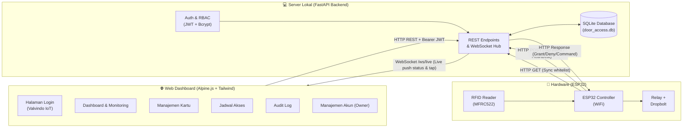
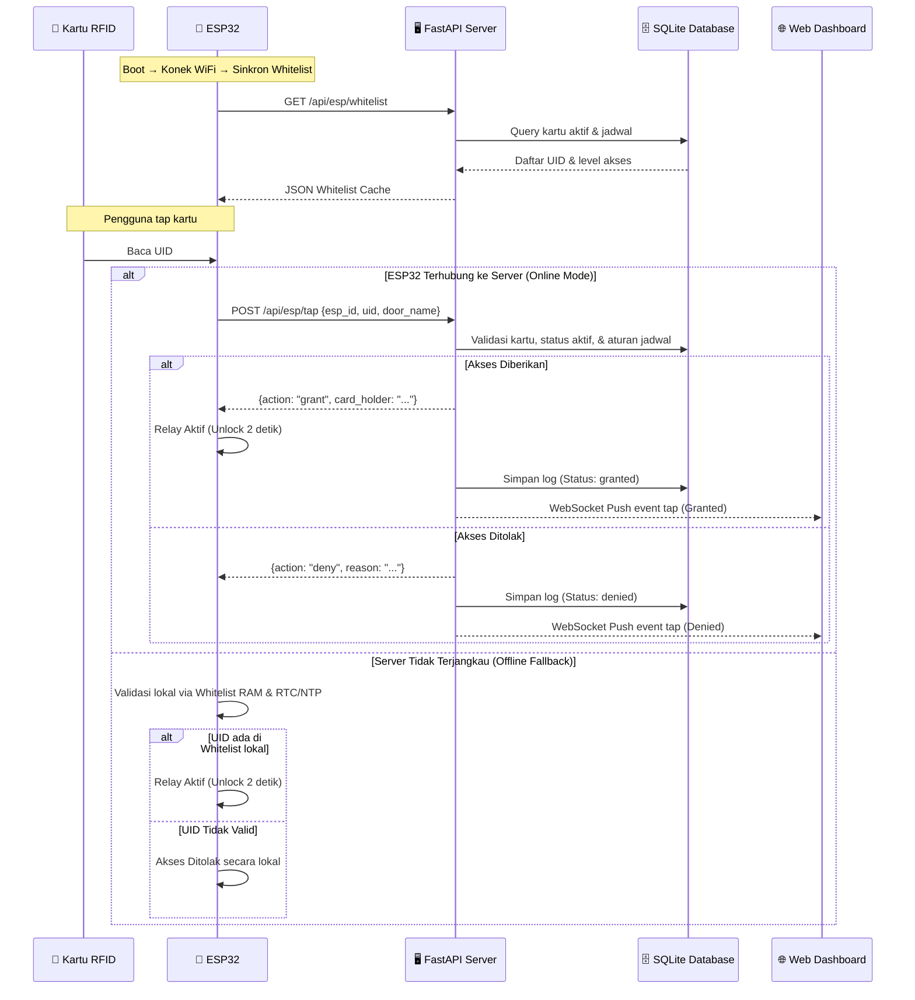
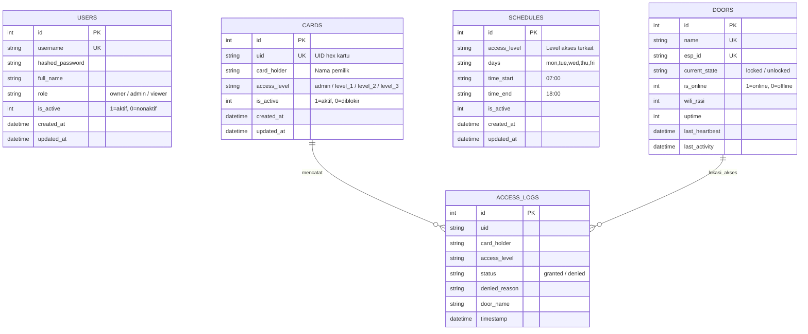
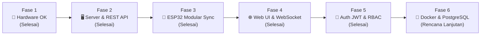

# 🏗️ Arsitektur Sistem — IoT RFID Door Access Control

## 1. Ringkasan

Sistem **kontrol akses pintu & manajemen audit berbasis IoT RFID** dengan prinsip arsitektur terdistribusi:

- ✅ **ESP32 menangani hardware & offline failover**: Membaca RFID (MFRC522), kontrol relay solenoid/dropbolt, sinkronisasi whitelist, dan heartbeat. Jika server tidak terjangkau, ESP32 tetap dapat memvalidasi kartu melalui cache whitelist lokal di memori.
- ✅ **Server lokal (FastAPI) sebagai pusat kontrol**: Menangani logika bisnis, otorisasi pengguna berbasis peran (RBAC), database audit, integrasi WebSocket real-time, dan penyedia web dashboard.
- ✅ **Akses multi-peran & aman**: Dilengkapi autentikasi JWT, hashing password (bcrypt), dan pembatasan hak akses berjenjang (Owner, Admin, Viewer).
- ✅ **Tech stack ringan & mandiri**: Berjalan secara lokal di jaringan area lokal (LAN) tanpa ketergantungan cloud pihak ketiga.

---

## 2. Arsitektur Sistem



### Alur Komunikasi Tap Kartu



---

## 3. Tech Stack

| Lapisan | Teknologi | Alasan Pemilihan |
|---|---|---|
| **Firmware ESP32** | C++ / Arduino Framework | Kinerja tinggi, dukungan native SPI MFRC522, HTTPClient, dan FreeRTOS. |
| **Backend Framework** | **FastAPI (Python 3.12)** | Asynchronous (ASGI), sangat cepat, dokumentasi OpenAPI/Swagger bawaan, WebSocket native. |
| **Keamanan & Auth** | **JWT (`python-jose`) + Native `bcrypt`** | Autentikasi stateless berbasis token standar industri dengan enkripsi password searah yang aman. |
| **Database** | **SQLite (`aiosqlite`)** | Ringan, file tunggal tanpa konfigurasi database server rumit, fully async. |
| **Frontend Framework** | **HTML5 + Tailwind CSS + Alpine.js** | Ringan, reaktif tanpa perlu Node.js build-step (bundler), pemeliharaan sangat mudah. |
| **Tipografi & Ikon** | **Google Fonts (Open Sans)** + FontAwesome 6 | Tampilan bersih, modern, dan konsisten di seluruh layar sistem. |
| **Komunikasi Real-time** | **WebSocket (`/ws/live`)** | Push log aktivitas kartu dan status hardware secara seketika (sub-detik) ke browser. |

---

## 4. Struktur Database & Model Data



### Skema Tabel SQLite

1. **`users`**: Akun pengguna web dashboard.
   - Kolom: `id`, `username`, `hashed_password`, `full_name`, `role`, `is_active`, `created_at`, `updated_at`.
   - Seeding otomatis: Akun default Owner (`superadmin` / `owner123`).
2. **`cards`**: Daftar kartu RFID terdaftar.
   - Kolom: `id`, `uid`, `card_holder`, `access_level`, `is_active`, `created_at`, `updated_at`.
3. **`schedules`**: Pengaturan rentang waktu dan hari akses berdasarkan level.
   - Kolom: `id`, `access_level`, `days`, `time_start`, `time_end`, `is_active`, `created_at`, `updated_at`.
4. **`access_logs`**: Riwayat audit setiap kali ada kartu yang ditempelkan.
   - Kolom: `id`, `uid`, `card_holder`, `access_level`, `status`, `denied_reason`, `door_name`, `timestamp`.
5. **`doors`**: Status perangkat keras dan status kunci.
   - Kolom: `id`, `name`, `esp_id`, `current_state`, `is_online`, `wifi_rssi`, `uptime`, `last_heartbeat`, `last_activity`.

---

## 5. Sistem Keamanan & Hak Akses (RBAC)

Sistem menerapkan pembatasan hak akses berbasis peran bertingkat:

| Peran (Role) | Deskripsi | Hak Akses Dashboard | Hak Akses Operasional IoT | Manajemen Akun Web |
|---|---|---|---|---|
| **👑 Owner** | Super Administrator (Akun sistem bawaan) | Full akses ke semua halaman | Full (Unlock remote, tambah/hapus kartu, jadwal) | ✅ Tambah, hapus, kelola akun Admin & Viewer |
| **🛠️ Admin** | Administrator Operasional | Full akses (Dashboard, Kartu, Jadwal, Log) | Full (Unlock remote, tambah/hapus kartu, jadwal) | ❌ Tidak dapat melihat atau mengelola akun web |
| **👁️ Viewer** | Pengawas / Pemantau (Read-only) | Hanya Dashboard & Log Akses | ❌ Tombol unlock, edit kartu, dan jadwal disembunyikan & diblokir | ❌ Tidak memiliki akses |

### Mekanisme Pengamanan:
- **FastAPI Dependency Injection**: `require_role(["owner", "admin"])` memvalidasi klaim token sebelum mengeksekusi logika endpoint.
- **Frontend Protection**: Auth Guard JavaScript pada tag `<head>` memeriksa keberadaan JWT token di `localStorage` dan mengarahkan otomatis ke `/login` jika sesi tidak valid.
- **Dynamic Alpine UI**: Direktif `x-show` menyembunyikan tombol aksi kritis (seperti *Remote Unlock* atau menu *Manajemen Akun*) berdasarkan peran yang sedang login.
- **Log Noise Suppression**: `FaviconLogFilter` dan endpoint `/favicon.ico` 204 No Content mencegah log terminal dipenuhi error 404 dari browser.

---

## 6. Daftar Endpoint API

### 🔐 Autentikasi & Akun (`/api/auth`, `/api/users`)
| Method | Endpoint | Peran yang Diizinkan | Deskripsi |
|---|---|---|---|
| `POST` | `/api/auth/login` | Publik | Otentikasi username & password, mengembalikan JWT token & role |
| `GET` | `/api/auth/me` | Owner, Admin, Viewer | Mengambil data profil pengguna yang sedang login |
| `GET` | `/api/users/` | Owner | Melihat daftar seluruh akun dashboard |
| `POST` | `/api/users/` | Owner | Menambahkan akun Admin atau Viewer baru |
| `DELETE` | `/api/users/{id}` | Owner | Menghapus akun pengguna (akun Owner tidak dapat dihapus) |

### 🪪 Manajemen Kartu & Jadwal (`/api/cards`, `/api/schedules`)
| Method | Endpoint | Peran yang Diizinkan | Deskripsi |
|---|---|---|---|
| `GET` | `/api/cards` | Owner, Admin, Viewer | Daftar kartu terdaftar dengan fitur pencarian dan paginasi |
| `GET` | `/api/cards/count`| Owner, Admin, Viewer | Total kartu terdaftar |
| `POST` | `/api/cards` | Owner, Admin | Mendaftarkan kartu RFID baru |
| `PUT` | `/api/cards/{id}` | Owner, Admin | Mengubah nama pemegang, level akses, atau status blokir |
| `DELETE`| `/api/cards/{id}` | Owner, Admin | Menghapus kartu dari database |
| `GET` | `/api/schedules` | Owner, Admin, Viewer | Mengambil daftar aturan jadwal akses |
| `POST` | `/api/schedules` | Owner, Admin | Menambahkan aturan jadwal baru |
| `PUT` | `/api/schedules/{id}` | Owner, Admin | Mengubah aturan jadwal |
| `DELETE`| `/api/schedules/{id}` | Owner, Admin | Menghapus aturan jadwal |

### 🚪 Kontrol Pintu, Log & Hardware (`/api/doors`, `/api/logs`, `/api/esp`)
| Method | Endpoint | Peran yang Diizinkan | Deskripsi |
|---|---|---|---|
| `GET` | `/api/dashboard/stats` | Owner, Admin, Viewer | Data statistik ringkasan dan status pintu untuk dashboard utama |
| `GET` | `/api/doors` | Owner, Admin, Viewer | Mengambil status seluruh pintu |
| `POST` | `/api/doors/{id}/unlock` | Owner, Admin | Perintah membuka pintu secara remote dari web |
| `GET` | `/api/logs` | Owner, Admin, Viewer | Riwayat log akses dengan filter tanggal, pencarian, dan status |
| `GET` | `/api/logs/export` | Owner, Admin, Viewer | Ekspor data riwayat akses ke format file CSV |
| `POST` | `/api/esp/tap` | ESP32 Hardware | Memproses ketukan kartu dan verifikasi izin akses |
| `POST` | `/api/esp/heartbeat` | ESP32 Hardware | Menerima heartbeat berkala, RSSI WiFi, dan uptime perangkat |
| `POST` | `/api/esp/door-status` | ESP32 Hardware | Memperbarui status fisik pintu (terkunci / terbuka) |
| `GET` | `/api/esp/whitelist` | ESP32 Hardware | Mengirimkan cache daftar UID dan level ke ESP32 |
| `POST` | `/api/esp/register-mode` | Owner, Admin | Mengaktifkan mode scan pendaftaran kartu baru pada hardware |
| `POST` | `/api/esp/cancel-register` | Owner, Admin | Membatalkan mode scan pendaftaran kartu |
| `WS` | `/ws/live` | Owner, Admin, Viewer | Saluran WebSocket untuk siaran log tap dan status hardware real-time |
| `GET` | `/favicon.ico` | Publik | Handler 204 No Content untuk mengeliminasi log bising browser |

---

## 7. Struktur Direktori Proyek

```
Aplikasi/
│
├── code esp32/                        # Firmware ESP32 Modular
│   ├── config.h                       # Konfigurasi PIN, WiFi, Server URL, Delay
│   ├── wifi_manager.h / .cpp          # Pengelola koneksi WiFi & NTP time sync
│   ├── rfid_handler.h / .cpp          # Handler komunikasi SPI modul MFRC522
│   ├── relay_control.h / .cpp         # Driver relay dropbolt (Active-LOW)
│   ├── access_control.h / .cpp        # Logika validasi akses & cache whitelist lokal
│   ├── api_client.h / .cpp            # Klien HTTP REST (Sync, Tap, Heartbeat)
│   ├── test_dropbolt_rfid.ino         # File utama sketch Arduino ESP32
│   └── arduino.c++                    # Backup draft kode awal
│
├── server/                            # Backend & Frontend Service
│   ├── main.py                        # Entry point FastAPI, WebSocket, static mount
│   ├── config.py                      # Konfigurasi server, database, secret key JWT
│   ├── database.py                    # Setup aiosqlite, inisialisasi skema, seed owner
│   ├── models.py                      # Model skema Pydantic untuk request & response
│   ├── auth.py                        # Core autentikasi (JWT decode, bcrypt, RBAC)
│   ├── requirements.txt               # Daftar dependensi Python
│   │
│   ├── data/
│   │   └── door_access.db             # File database SQLite lokal
│   │
│   ├── routers/
│   │   ├── auth.py                    # Endpoint login & informasi pengguna
│   │   ├── users.py                   # Endpoint CRUD manajemen akun web (Owner only)
│   │   ├── cards.py                   # Endpoint CRUD manajemen kartu RFID
│   │   ├── schedules.py               # Endpoint CRUD aturan jadwal akses
│   │   ├── doors.py                   # Endpoint status pintu & remote unlock
│   │   ├── logs.py                    # Endpoint riwayat akses & ekspor CSV
│   │   └── esp.py                     # Endpoint komunikasi perangkat ESP32
│   │
│   └── static/                        # Frontend Web Dashboard (SPA-like Static)
│       ├── login.html                 # Halaman login (2 kolom: Brand Valvindo IoT)
│       ├── index.html                 # Dashboard pemantauan real-time
│       ├── users.html                 # Halaman manajemen pengguna web (Owner)
│       ├── cards.html                 # Halaman manajemen kartu RFID
│       ├── schedule.html              # Halaman manajemen jadwal akses
│       ├── logs.html                  # Halaman log akses & unduh CSV
│       │
│       ├── img/
│       │   └── LOGO SEKUNDER.png      # Aset logo resmi Valvindo IoT
│       ├── css/
│       │   ├── tailwind.css           # Framework styling Tailwind CSS
│       │   └── all.min.css            # FontAwesome Iconset
│       ├── js/
│       │   └── alpine.js              # Framework reaktivitas Alpine.js
│       └── webfonts/                  # File font aset pendukung
│
├── ARSITEKTUR_SISTEM.md               # Dokumentasi arsitektur sistem (file ini)
├── PROGRESS_REPORT.md                 # Laporan progres pengerjaan proyek
├── SKEMA_PROJECT.md                   # Skema rangkaian & wiring hardware
└── PRD.md                             # Product Requirements Document
```

---

## 8. Tampilan & Antarmuka Frontend

Seluruh halaman antarmuka web dibangun menggunakan standar visual yang terpadu:
- **Tipografi Global**: Menggunakan font modern **Open Sans** dari Google Fonts.
- **Identitas Visual**: Brand warna resmi **Valvindo IoT** (`#002062`).
- **Halaman Login (`/login`)**:
  - Layout 2 kolom (Split Card):
    - Sisi Kiri: Logo resmi `LOGO SEKUNDER.png`, teks brand "Valvindo IoT" (`#002062`), dan keterangan sistem.
    - Sisi Kanan: Form masukan username & password dengan tombol aksi warna brand.
- **Halaman Manajemen Akun (`/users`)**: Khusus role Owner untuk menambah pengguna, menetapkan role (Admin / Viewer), dan menghapus akses.
- **Sidebar Terpadu**: Navigasi responsif dengan tombol *Logout* dan filter visibilitas menu berbasis peran pengguna aktif.

---

## 9. Petunjuk Menjalankan Server

### 1. Di Komputer / Server Lokal
Pastikan Python 3.10+ sudah terinstal:

```powershell
# Buka folder server
cd "D:\Folder nyampah\ac dev\Aplikasi\server"

# Install dependensi
pip install -r requirements.txt

# Jalankan server FastAPI
python main.py
# atau
uvicorn main:app --host 0.0.0.0 --port 8000 --reload
```

Kredensial Default Awal:
- **URL Dashboard**: `http://localhost:8000/`
- **Username**: `superadmin`
- **Password**: `owner123`
- **Peran**: `owner`

### 2. Di Mikrokontroler ESP32
1. Buka sketch Arduino pada folder `code esp32/test_dropbolt_rfid.ino`.
2. Sesuaikan konfigurasi SSID, password WiFi, dan IP server laptop pada `config.h`.
3. Hubungkan ESP32 ke port USB dan upload menggunakan Arduino IDE (Board: ESP32 Dev Module).

---

## 10. Roadmap Pengembangan



| Fase | Uraian Pekerjaan | Status |
|---|---|:---:|
| **Fase 1** | Perakitan & pengujian rangkaian hardware (ESP32, MFRC522, Relay Dropbolt) | ✅ Selesai |
| **Fase 2** | Pembuatan backend FastAPI, aiosqlite, router cards, doors, logs, schedules, esp | ✅ Selesai |
| **Fase 3** | Refactor firmware modular ESP32 dengan failover offline whitelist | ✅ Selesai |
| **Fase 4** | Pembuatan Web Dashboard interaktif (Alpine.js + Tailwind + WebSocket real-time) | ✅ Selesai |
| **Fase 5** | Sistem Autentikasi JWT, Native Bcrypt, RBAC (Owner/Admin/Viewer), Manajemen Akun & Redesain Login | ✅ Selesai |
| **Fase 6** | Dockerisasi penuh (Docker Compose) & opsi migrasi ke database PostgreSQL | 🔲 Rencana |
