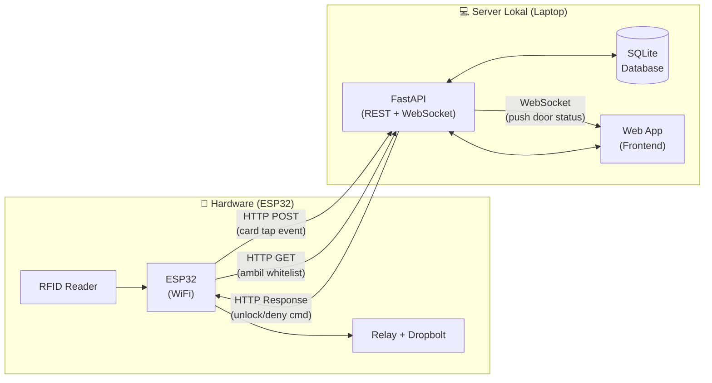
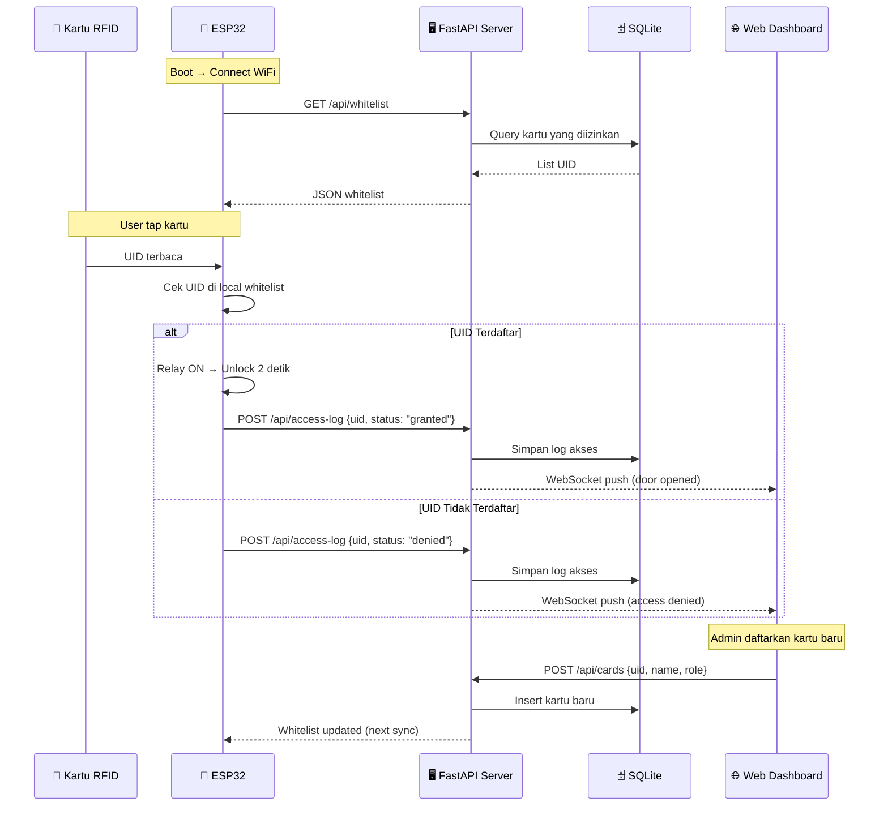
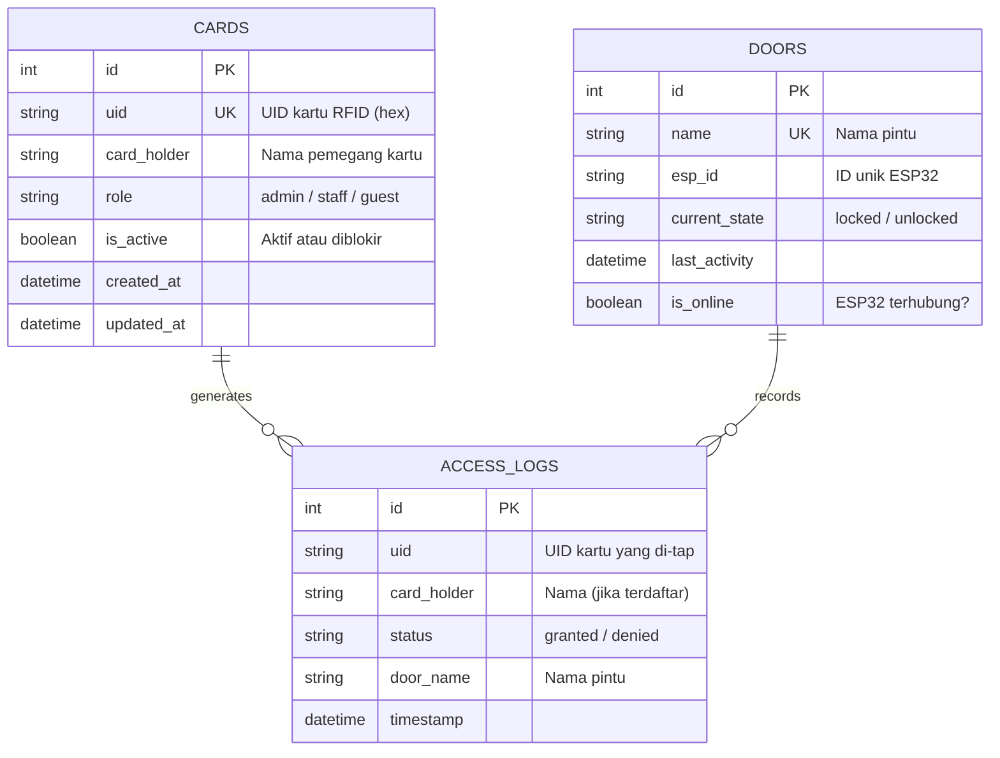
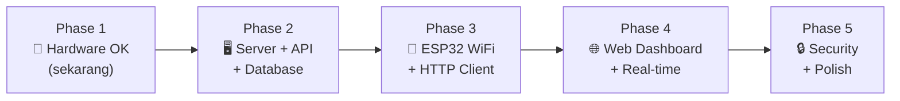

# 🏗️ Arsitektur Sistem — IoT RFID Door Access Control

## 1. Ringkasan

Membangun **aplikasi web monitoring & manajemen akses pintu** berbasis RFID, dengan prinsip:

- ✅ **ESP32 hanya handle hardware** (baca RFID, kontrol relay, kirim status)
- ✅ **Semua logic, database, web app di server lokal** (laptop)
- ✅ **Tech stack ringan** — bisa jalan di laptop biasa tanpa ribet

---

## 2. Arsitektur Sistem



### Alur Komunikasi



---

## 3. Rekomendasi Tech Stack

### Kenapa Stack Ini?

| Kriteria | Pilihan | Alasan |
|----------|---------|--------|
| **Bahasa Backend** | **Python** | Mudah dipelajari, ekosistem besar |
| **Framework API** | **FastAPI** | Ringan, cepat, auto-generate docs (Swagger), WebSocket built-in |
| **Database** | **SQLite** | File tunggal, 0 konfigurasi, cukup untuk 1 pintu / ratusan user |
| **Frontend** | **HTML + Tailwind CSS + Alpine.js** | Tanpa build step, ringan, cukup untuk dashboard |
| **Komunikasi ESP↔Server** | **HTTP REST** | Simple, ESP32 sudah ada library `HTTPClient` |
| **Real-time ke Browser** | **WebSocket** | Push update instan ke dashboard |
| **ESP32 Library WiFi** | **WiFi.h + HTTPClient.h** | Built-in, tidak perlu install tambahan |

> [!TIP]
> **Kenapa bukan MQTT?** MQTT lebih proper untuk IoT skala besar, tapi butuh install broker (Mosquitto) terpisah. Untuk prototype 1 pintu di jaringan lokal, **HTTP REST sudah lebih dari cukup** dan lebih mudah di-debug.

### Perbandingan Opsi

| | **Opsi A: FastAPI + SQLite** ⭐ | **Opsi B: Express.js + SQLite** | **Opsi C: Flask + SQLite** |
|---|---|---|---|
| Bahasa | Python | JavaScript (Node.js) | Python |
| Performa | ⚡ Sangat cepat (async) | ⚡ Cepat | 🐢 Sync (lebih lambat) |
| WebSocket | ✅ Built-in | ✅ via socket.io | ⚠️ Perlu Flask-SocketIO |
| Auto API Docs | ✅ Swagger UI otomatis | ❌ Manual | ❌ Manual |
| Learning Curve | Mudah | Mudah | Mudah |
| Install | `pip install fastapi uvicorn` | `npm install express` | `pip install flask` |

> **Rekomendasi: Opsi A (FastAPI + SQLite)** — paling ringan, fitur paling lengkap untuk kebutuhan ini.

---

## 4. Struktur Database (SQLite)



### Tabel SQL

```sql
-- Daftar kartu yang diizinkan
CREATE TABLE cards (
    id INTEGER PRIMARY KEY AUTOINCREMENT,
    uid TEXT UNIQUE NOT NULL,          -- UID hex, misal "A3 B2 C1 D0"
    card_holder TEXT NOT NULL,          -- Nama orang
    role TEXT DEFAULT 'staff',          -- admin / staff / guest
    is_active BOOLEAN DEFAULT 1,       -- 1 = boleh akses, 0 = diblokir
    created_at DATETIME DEFAULT CURRENT_TIMESTAMP,
    updated_at DATETIME DEFAULT CURRENT_TIMESTAMP
);

-- Log setiap kali kartu di-tap
CREATE TABLE access_logs (
    id INTEGER PRIMARY KEY AUTOINCREMENT,
    uid TEXT NOT NULL,
    card_holder TEXT,
    status TEXT NOT NULL,              -- 'granted' atau 'denied'
    door_name TEXT DEFAULT 'Pintu Utama',
    timestamp DATETIME DEFAULT CURRENT_TIMESTAMP
);

-- Data pintu & status ESP32
CREATE TABLE doors (
    id INTEGER PRIMARY KEY AUTOINCREMENT,
    name TEXT UNIQUE NOT NULL,
    esp_id TEXT UNIQUE,
    current_state TEXT DEFAULT 'locked',
    last_activity DATETIME,
    is_online BOOLEAN DEFAULT 0
);
```

---

## 5. API Endpoints

| Method | Endpoint | Fungsi | Dipanggil oleh |
|--------|----------|--------|----------------|
| `GET` | `/api/whitelist` | Ambil daftar UID yang boleh akses | ESP32 |
| `POST` | `/api/access-log` | Kirim log tap kartu | ESP32 |
| `POST` | `/api/door-status` | Update status pintu (locked/unlocked) | ESP32 |
| `GET` | `/api/heartbeat` | ESP32 ping → server tahu ESP online | ESP32 |
| `GET` | `/api/cards` | Daftar semua kartu | Web App |
| `POST` | `/api/cards` | Tambah kartu baru | Web App |
| `PUT` | `/api/cards/{id}` | Edit kartu (nama, status aktif) | Web App |
| `DELETE` | `/api/cards/{id}` | Hapus kartu | Web App |
| `GET` | `/api/logs` | Ambil log akses (filter by date, uid) | Web App |
| `GET` | `/api/doors` | Status semua pintu | Web App |
| `POST` | `/api/doors/{id}/unlock` | Remote unlock dari web | Web App |
| `WS` | `/ws/live` | Real-time push ke dashboard | Web App |

---

## 6. Struktur Folder Project

```
IoT-Prototype/
│
├── firmware/                     # Kode ESP32
│   └── rfid_door_access/
│       └── rfid_door_access.ino  # Sketch Arduino (WiFi + HTTP)
│
├── server/                       # Backend + Frontend
│   ├── main.py                   # FastAPI app entry point
│   ├── database.py               # SQLite setup & helper
│   ├── models.py                 # Pydantic models (request/response)
│   ├── routers/
│   │   ├── cards.py              # CRUD kartu
│   │   ├── logs.py               # Access logs
│   │   ├── doors.py              # Door status & control
│   │   └── esp.py                # Endpoint khusus ESP32
│   ├── static/                   # Frontend files
│   │   ├── index.html            # Dashboard utama
│   │   ├── cards.html            # Halaman manajemen kartu
│   │   ├── logs.html             # Halaman log akses
│   │   ├── css/
│   │   │   └── style.css
│   │   └── js/
│   │       ├── dashboard.js      # WebSocket + live status
│   │       └── cards.js          # CRUD kartu frontend
│   ├── door_access.db            # SQLite database file (auto-created)
│   └── requirements.txt          # Python dependencies
│
├── test_dropbolt_rfid/           # (kode testing awal yg sudah ada)
│   ├── test_dropbolt_rfid.ino
│   └── arduino.c++
│
├── SKEMA_PROJECT.md              # Dokumentasi skema hardware
└── ARSITEKTUR_SISTEM.md          # Dokumentasi ini
```

---

## 7. Fitur Web Dashboard

### 7.1 Halaman Dashboard (Home)
- 🟢 Status pintu real-time (Locked / Unlocked)
- 🟢 Status ESP32 (Online / Offline)
- 📊 Statistik hari ini (total tap, granted, denied)
- 📋 5 log akses terakhir (live update via WebSocket)

### 7.2 Halaman Manajemen Kartu
- ➕ Tambah kartu baru (input UID manual atau tap langsung)
- ✏️ Edit nama & role pemegang kartu
- 🔴 Blokir / aktifkan kartu
- 🗑️ Hapus kartu

### 7.3 Halaman Log Akses
- 📋 Tabel log akses lengkap
- 🔍 Filter berdasarkan tanggal, nama, status
- 📥 Export ke CSV

### 7.4 Remote Control
- 🔓 Tombol unlock pintu dari web (emergency)

---

## 8. Kebutuhan Install

### Di Laptop (Server)

```bash
# 1. Install Python 3.10+
# 2. Install dependencies
pip install fastapi uvicorn aiosqlite python-multipart

# 3. Jalankan server
uvicorn main:app --host 0.0.0.0 --port 8000 --reload
```

> [!IMPORTANT]
> Gunakan `--host 0.0.0.0` agar ESP32 bisa akses server via WiFi (bukan hanya localhost).

### Di ESP32

Library Arduino yang diperlukan:
- `WiFi.h` (built-in)
- `HTTPClient.h` (built-in)
- `ArduinoJson.h` (install via Library Manager)
- `SPI.h` (built-in)
- `MFRC522.h` (install via Library Manager)

---

## 9. Keamanan Jaringan

> [!WARNING]
> Karena ini di jaringan lokal, pastikan:

- Laptop & ESP32 di **WiFi yang sama** (1 subnet)
- Jika pakai hotspot HP, pastikan **AP isolation dimatikan**
- Untuk production, tambahkan **API key** di header request ESP32
- Set **firewall** laptop agar port 8000 hanya bisa diakses dari IP lokal

---

## 10. Roadmap Development



| Phase | Task | Estimasi |
|-------|------|----------|
| **1** ✅ | Hardware testing (RFID + Relay + Dropbolt) | Selesai |
| **2** | Setup FastAPI + SQLite + API endpoints | 1-2 hari |
| **3** | Update firmware ESP32 (WiFi + HTTP request) | 1 hari |
| **4** | Build web dashboard (status, kartu, log) | 2-3 hari |
| **5** | Testing integrasi, security, polish UI | 1-2 hari |

---

*Dokumen ini dibuat: 23 September 2026*
