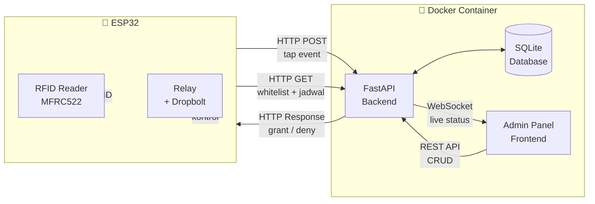
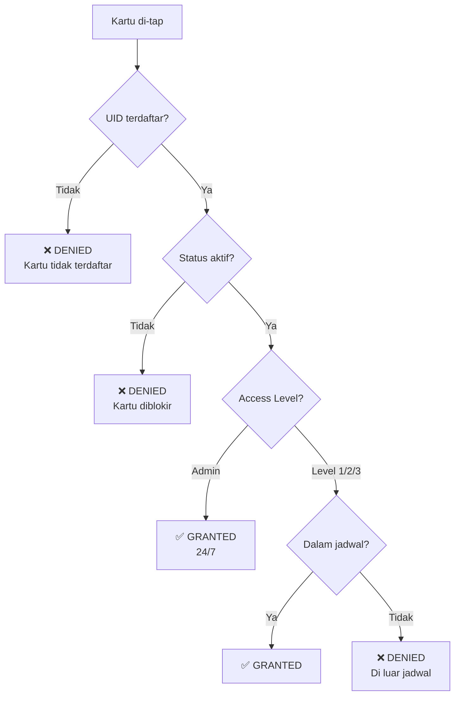
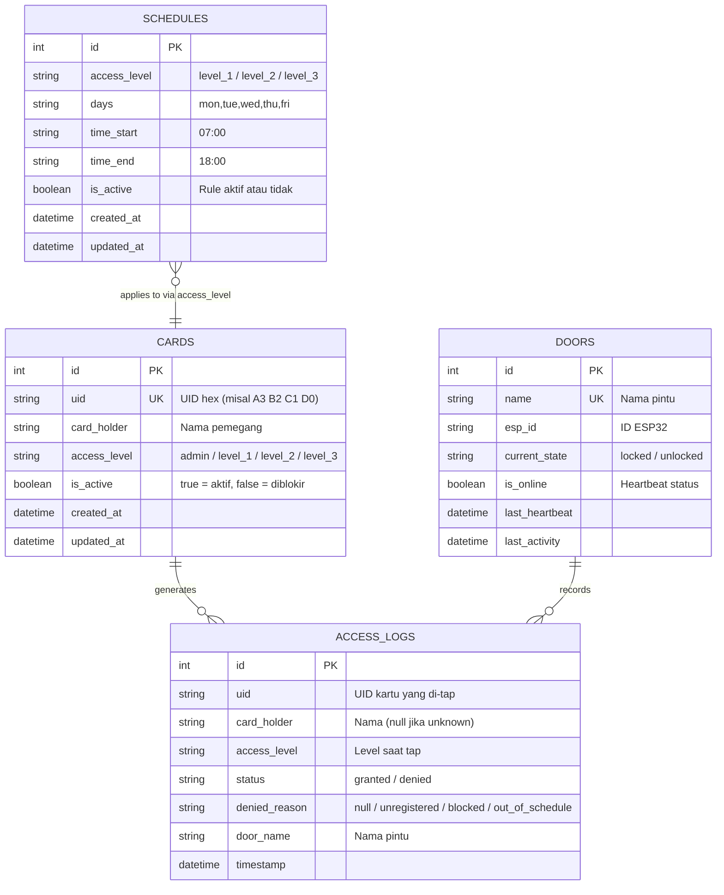
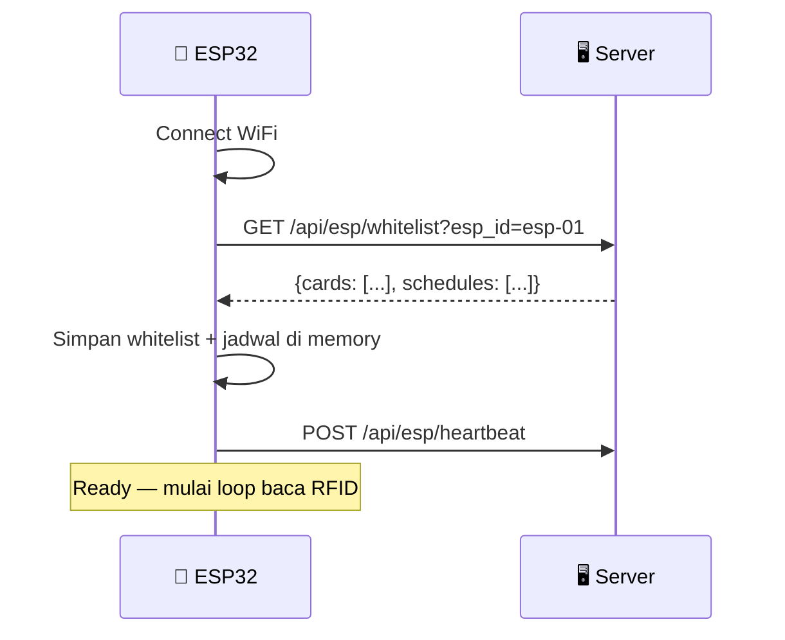
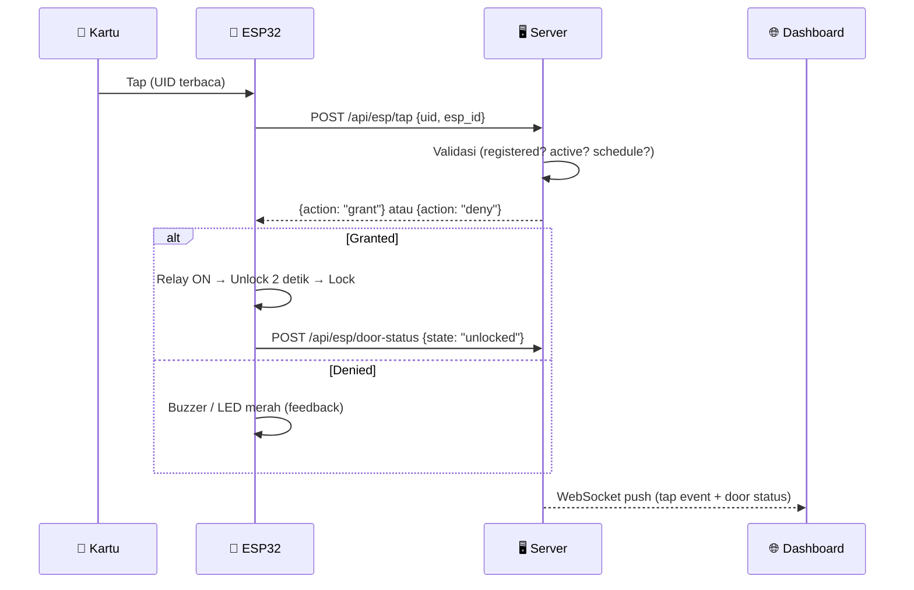
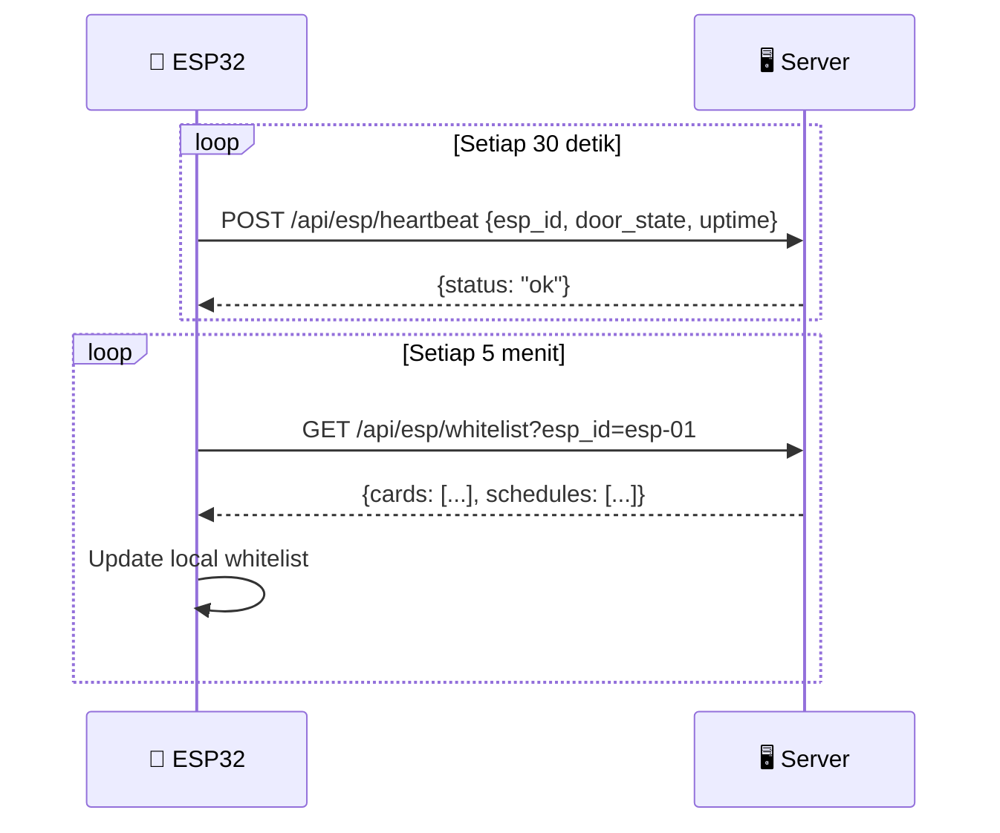

# 📄 Product Requirements Document (PRD)
## IoT RFID Access Control System

| Field | Detail |
|-------|--------|
| **Project** | IoT RFID Door Access Control |
| **Versi** | 1.0 |
| **Tanggal** | 23 September 2026 |
| **Status** | Draft |

---

## 1. Latar Belakang

Dibutuhkan sistem kontrol akses pintu berbasis RFID yang terintegrasi dengan web admin panel untuk monitoring, registrasi kartu, pencatatan log, dan pengaturan jadwal akses. Sistem berjalan di **server lokal** menggunakan **Docker**, dengan ESP32 sebagai perangkat hardware yang hanya menangani komunikasi dan kontrol fisik (baca kartu RFID, kontrol relay/dropbolt).

---

## 2. Tujuan

1. Mengontrol akses pintu menggunakan kartu RFID
2. Menyediakan admin panel untuk mengelola kartu, monitoring, dan jadwal
3. Mencatat seluruh aktivitas tap kartu sebagai log audit
4. Mengatur jadwal kapan kartu tertentu boleh/tidak boleh scan berdasarkan access level

---

## 3. User & Role

Sistem menerapkan **Role-Based Access Control (RBAC)** dengan pemisahan peran web dashboard dan pemegang kartu:

| Role | Tipe Pengguna | Hak Akses Sistem |
|---|---|---|
| **👑 Owner** | Web Dashboard | Hak akses tertinggi (Super Admin). Pengelolaan sistem penuh serta manajemen akun web (tambah, edit peran, dan hapus user Admin/Viewer). |
| **🛠️ Admin** | Web Dashboard | Operasional IoT penuh (Remote unlock, CRUD kartu RFID, pengaturan jadwal akses, monitoring). Tidak dapat mengelola akun web. |
| **👁️ Viewer** | Web Dashboard | Pemantau (Read-only). Hanya dapat melihat dashboard monitoring dan riwayat audit log. Seluruh aksi kontrol disembunyikan. |
| **🪪 Cardholder** | Fisik / Hardware | Pemegang kartu RFID fisik yang menempelkan kartu ke reader untuk membuka kunci pintu. |

> [!NOTE]
> Sistem autentikasi web menggunakan **JSON Web Token (JWT)** stateless dengan hashing password native **bcrypt** dan auto-seed akun awal Owner (`superadmin` / `owner123`).

---

## 4. Tech Stack

| Layer | Teknologi |
|-------|-----------|
| **Hardware** | ESP32 + MFRC522 RFID + Relay + Dropbolt |
| **Firmware** | Arduino C++ (WiFi + HTTPClient + ArduinoJson) |
| **Backend** | Python — FastAPI |
| **Database** | SQLite |
| **Frontend** | HTML + Tailwind CSS + Alpine.js (tanpa build step) |
| **Real-time** | WebSocket (FastAPI built-in) |
| **Deployment** | Docker + Docker Compose (server lokal) |

---

## 5. Arsitektur Sistem



---

## 6. Fitur & Halaman Admin Panel

### 6.1 🏠 Home — Monitoring Hardware

**Tujuan:** Menampilkan status hardware dan ringkasan sistem secara real-time.

#### Konten Halaman

| Komponen | Detail |
|----------|--------|
| **Status ESP32** | 🟢 Online / 🔴 Offline (berdasarkan heartbeat terakhir) |
| **Status Pintu** | 🔒 Locked / 🔓 Unlocked |
| **Terakhir Diakses** | Nama + waktu tap terakhir |
| **Statistik Hari Ini** | Total tap, total granted, total denied |
| **Live Feed** | 5 log tap terakhir, update real-time via WebSocket |
| **Uptime** | Sejak kapan ESP32 terakhir online |

#### Wireframe

```
┌──────────────────────────────────────────────────────────┐
│  🏠 Home — Monitoring                                    │
├──────────────────────────────────────────────────────────┤
│                                                          │
│  ┌─────────────┐  ┌─────────────┐  ┌─────────────┐      │
│  │  ESP32       │  │  Pintu      │  │  Hari Ini   │      │
│  │  🟢 Online   │  │  🔒 Locked  │  │  📊 48 tap  │      │
│  │  Uptime: 3h  │  │             │  │  ✅ 45  ❌ 3 │      │
│  └─────────────┘  └─────────────┘  └─────────────┘      │
│                                                          │
│  📋 Live Feed (Real-time)                                │
│  ┌──────────────────────────────────────────────────┐    │
│  │ 10:15:03  ✅ Budi Santoso        Pintu Utama     │    │
│  │ 10:12:45  ✅ Rina Maharani       Pintu Utama     │    │
│  │ 10:08:21  ❌ Unknown (A3 B2..)   Pintu Utama     │    │
│  │ 09:55:10  ✅ Ahmad Fauzi         Pintu Utama     │    │
│  │ 09:41:33  ✅ Budi Santoso        Pintu Utama     │    │
│  └──────────────────────────────────────────────────┘    │
│                                                          │
└──────────────────────────────────────────────────────────┘
```

---

### 6.2 📇 Registration — Manajemen Kartu

**Tujuan:** Mendaftarkan kartu RFID baru, mengatur access level, dan mengelola status kartu (aktif/blokir).

#### Fitur CRUD

| Aksi | Detail |
|------|--------|
| **Create** | Tambah kartu baru: input UID, nama pemegang, access level |
| **Read** | Tampilkan tabel semua kartu terdaftar |
| **Update** | Edit nama, access level, atau status aktif/blokir |
| **Delete** | Hapus kartu dari sistem |

#### Form Registrasi

| Field | Tipe | Keterangan |
|-------|------|------------|
| **UID Kartu** | Text (read-only jika via tap) | Bisa input manual atau tap kartu ke reader lalu server tangkap UID |
| **Nama Pemegang** | Text | Nama lengkap |
| **Access Level** | Dropdown | Level 1 / Level 2 / Level 3 / Admin (lihat §6.4) |
| **Status** | Toggle | Aktif ✅ / Diblokir 🚫 |

#### Tabel Daftar Kartu

| Kolom | Keterangan |
|-------|------------|
| No | Nomor urut |
| UID | UID kartu (hex) |
| Nama | Nama pemegang kartu |
| Access Level | Level akses (1/2/3/Admin) |
| Status | Badge: Aktif (hijau) / Diblokir (merah) |
| Terdaftar Sejak | Tanggal registrasi |
| Aksi | Tombol Edit ✏️ / Blokir 🚫 / Hapus 🗑️ |

#### Wireframe

```
┌──────────────────────────────────────────────────────────┐
│  📇 Registration — Manajemen Kartu                       │
├──────────────────────────────────────────────────────────┤
│                                                          │
│  ➕ Tambah Kartu Baru                                    │
│  ┌──────────────────────────────────────────────────┐    │
│  │  UID Kartu:    [_______________] [📡 Tap Kartu]  │    │
│  │  Nama:         [_______________]                  │    │
│  │  Access Level: [▼ Level 1     ]                   │    │
│  │                          [💾 Simpan] [Batal]      │    │
│  └──────────────────────────────────────────────────┘    │
│                                                          │
│  🔍 Cari: [______________]                               │
│                                                          │
│  ┌────┬──────────┬───────────────┬─────────┬────────┬───┐│
│  │ No │ UID      │ Nama          │ Level   │ Status │ ⚙ ││
│  ├────┼──────────┼───────────────┼─────────┼────────┼───┤│
│  │ 1  │ A3 B2 C1 │ Budi Santoso  │ Admin   │ ✅ Aktif│ ✏🗑││
│  │ 2  │ D4 E5 F6 │ Rina Maharani │ Level 1 │ ✅ Aktif│ ✏🗑││
│  │ 3  │ G7 H8 I9 │ Ahmad Fauzi   │ Level 2 │ 🚫 Blok│ ✏🗑││
│  └────┴──────────┴───────────────┴─────────┴────────┴───┘│
│                                                          │
│  Showing 1-3 of 3 entries          [< 1 >]              │
└──────────────────────────────────────────────────────────┘
```

---

### 6.3 📋 Log — History Tapping

**Tujuan:** Menampilkan catatan/history setiap kali kartu di-tap di reader.

#### Informasi yang Dicatat per Tap

| Field | Detail |
|-------|--------|
| **Timestamp** | Tanggal dan jam tap |
| **UID** | UID kartu yang di-tap |
| **Nama** | Nama pemegang (jika terdaftar), "Unknown" jika tidak |
| **Access Level** | Level akses kartu |
| **Status** | ✅ Granted / ❌ Denied |
| **Alasan Denied** | Kartu tidak terdaftar / Diblokir / Di luar jadwal |
| **Pintu** | Nama pintu (untuk multi-door di masa depan) |

#### Fitur Halaman

| Fitur | Detail |
|-------|--------|
| **Filter tanggal** | Date range picker (dari — sampai) |
| **Filter status** | All / Granted / Denied |
| **Filter nama** | Search by nama pemegang |
| **Sorting** | Terbaru di atas (default), bisa sort by kolom |
| **Pagination** | 25 baris per halaman |
| **Export CSV** | Download log dalam format CSV |

#### Wireframe

```
┌──────────────────────────────────────────────────────────┐
│  📋 Log — History Tapping                                │
├──────────────────────────────────────────────────────────┤
│                                                          │
│  📅 Dari: [2026-09-01] Sampai: [2026-09-23]             │
│  🔍 Nama: [__________]  Status: [▼ All]  [🔎 Filter]   │
│                                            [📥 Export]   │
│                                                          │
│  ┌───────────┬──────────┬──────────────┬───────┬────────┐│
│  │ Waktu     │ UID      │ Nama         │ Level │ Status ││
│  ├───────────┼──────────┼──────────────┼───────┼────────┤│
│  │ 10:15:03  │ A3 B2 C1 │ Budi Santoso │ Admin │ ✅     ││
│  │ 10:12:45  │ D4 E5 F6 │ Rina M.      │ Lv.1  │ ✅     ││
│  │ 10:08:21  │ X1 Y2 Z3 │ Unknown      │ -     │ ❌     ││
│  │ 09:55:10  │ J1 K2 L3 │ Ahmad Fauzi  │ Lv.2  │ ❌     ││
│  │           │          │              │       │(di luar││
│  │           │          │              │       │jadwal) ││
│  └───────────┴──────────┴──────────────┴───────┴────────┘│
│                                                          │
│  Showing 1-25 of 148 entries       [< 1 2 3 4 5 6 >]    │
└──────────────────────────────────────────────────────────┘
```

---

### 6.4 📅 Schedule — Pengaturan Jadwal Akses

**Tujuan:** Mengatur kapan kartu dengan access level tertentu boleh atau tidak boleh melakukan scan.

#### Konsep Access Level

| Access Level | Deskripsi | Contoh |
|-------------|-----------|--------|
| **Admin** | Akses 24/7, tidak terpengaruh jadwal | IT Admin, Security |
| **Level 1** | Akses sesuai jadwal utama (jam kerja penuh) | Staff tetap |
| **Level 2** | Akses sesuai jadwal terbatas | Staff shift / part-time |
| **Level 3** | Akses hanya di jadwal khusus | Tamu / vendor |

#### Pengaturan Schedule per Access Level

| Field | Detail |
|-------|--------|
| **Access Level** | Pilih level yang mau diatur |
| **Hari** | Pilih hari (Senin-Minggu), bisa multiple |
| **Jam Mulai** | Waktu mulai boleh scan (HH:MM) |
| **Jam Selesai** | Waktu selesai boleh scan (HH:MM) |
| **Status Rule** | Aktif / Nonaktif |

#### Contoh Konfigurasi

| Access Level | Hari | Jam Mulai | Jam Selesai | Keterangan |
|-------------|------|-----------|-------------|------------|
| Admin | - | - | - | Selalu bisa akses (24/7) |
| Level 1 | Senin - Jumat | 07:00 | 18:00 | Jam kerja normal |
| Level 1 | Sabtu | 08:00 | 13:00 | Setengah hari |
| Level 2 | Senin - Jumat | 08:00 | 17:00 | Shift normal |
| Level 3 | Senin - Jumat | 09:00 | 16:00 | Jam tamu |

#### Logika Validasi di Server

```
Kartu di-tap
  → Cek UID ada di database?
    → TIDAK → DENIED (kartu tidak terdaftar)
    → YA → Cek status kartu aktif?
      → TIDAK → DENIED (kartu diblokir)
      → YA → Cek access level
        → ADMIN → GRANTED (selalu boleh)
        → Level 1/2/3 → Cek jadwal saat ini sesuai?
          → YA → GRANTED
          → TIDAK → DENIED (di luar jadwal)
```



#### Wireframe

```
┌──────────────────────────────────────────────────────────┐
│  📅 Schedule — Pengaturan Jadwal Akses                   │
├──────────────────────────────────────────────────────────┤
│                                                          │
│  ➕ Tambah Rule Jadwal                                   │
│  ┌──────────────────────────────────────────────────┐    │
│  │  Access Level: [▼ Level 1     ]                   │    │
│  │  Hari:         [☑ Sen ☑ Sel ☑ Rab ☑ Kam ☑ Jum    │    │
│  │                 ☐ Sab ☐ Min]                      │    │
│  │  Jam Mulai:    [07:00]                            │    │
│  │  Jam Selesai:  [18:00]                            │    │
│  │                          [💾 Simpan] [Batal]      │    │
│  └──────────────────────────────────────────────────┘    │
│                                                          │
│  📋 Jadwal Saat Ini                                      │
│  ┌─────────┬──────────────────┬───────┬───────┬────┬───┐│
│  │ Level   │ Hari             │ Mulai │Selesai│ On │ ⚙ ││
│  ├─────────┼──────────────────┼───────┼───────┼────┼───┤│
│  │ Admin   │ (Selalu 24/7)    │  -    │  -    │ ✅ │ - ││
│  │ Level 1 │ Sen-Jum          │ 07:00 │ 18:00 │ ✅ │ ✏🗑││
│  │ Level 1 │ Sab              │ 08:00 │ 13:00 │ ✅ │ ✏🗑││
│  │ Level 2 │ Sen-Jum          │ 08:00 │ 17:00 │ ✅ │ ✏🗑││
│  │ Level 3 │ Sen-Jum          │ 09:00 │ 16:00 │ ✅ │ ✏🗑││
│  └─────────┴──────────────────┴───────┴───────┴────┴───┘│
│                                                          │
└──────────────────────────────────────────────────────────┘
```

---

## 7. Navigasi Admin Panel

```
┌────────────────────────────────────────────────┐
│  🔐 IoT Access Control    [🏠] [📇] [📋] [📅] │
├────────────────────────────────────────────────┤
│                                                │
│              (Konten Halaman)                  │
│                                                │
└────────────────────────────────────────────────┘

🏠 = Home (Monitoring)
📇 = Registration (Kartu)
📋 = Log (History)
📅 = Schedule (Jadwal)
```

---

## 8. Database Schema



---

## 9. API Endpoints

### 9.1 ESP32 → Server

| Method | Endpoint | Body / Params | Response | Keterangan |
|--------|----------|---------------|----------|------------|
| `GET` | `/api/esp/whitelist` | `?esp_id=xxx` | `{cards: [{uid, access_level}], schedules: [...]}` | ESP ambil whitelist + jadwal saat boot & periodik |
| `POST` | `/api/esp/tap` | `{esp_id, uid, timestamp}` | `{action: "grant"/"deny", reason: "..."}` | ESP kirim tap event, server validasi & respond |
| `POST` | `/api/esp/heartbeat` | `{esp_id, door_state, uptime}` | `{status: "ok"}` | Heartbeat tiap 30 detik |
| `POST` | `/api/esp/door-status` | `{esp_id, state: "locked"/"unlocked"}` | `{status: "ok"}` | Update status pintu |

### 9.2 Web App → Server

| Method | Endpoint | Keterangan |
|--------|----------|------------|
| `GET` | `/api/cards` | List semua kartu (+ search, pagination) |
| `POST` | `/api/cards` | Tambah kartu baru |
| `PUT` | `/api/cards/{id}` | Edit kartu |
| `DELETE` | `/api/cards/{id}` | Hapus kartu |
| `GET` | `/api/logs` | List log akses (+ filter, pagination) |
| `GET` | `/api/logs/export` | Export log ke CSV |
| `GET` | `/api/schedules` | List semua rule jadwal |
| `POST` | `/api/schedules` | Tambah rule jadwal |
| `PUT` | `/api/schedules/{id}` | Edit rule jadwal |
| `DELETE` | `/api/schedules/{id}` | Hapus rule jadwal |
| `GET` | `/api/doors` | List semua pintu & statusnya |
| `POST` | `/api/doors/{id}/unlock` | Remote unlock |
| `GET` | `/api/dashboard/stats` | Statistik untuk home |
| `WS` | `/ws/live` | WebSocket real-time updates |

---

## 10. Alur Komunikasi ESP32

### 10.1 Saat Boot



### 10.2 Saat Kartu Di-tap



### 10.3 Sync Periodik



---

## 11. Struktur Folder Project

```
IoT-Prototype/
│
├── docker-compose.yml
├── Dockerfile
│
├── firmware/
│   └── rfid_door_access/
│       └── rfid_door_access.ino
│
├── server/
│   ├── main.py
│   ├── database.py
│   ├── models.py
│   ├── config.py
│   ├── requirements.txt
│   ├── routers/
│   │   ├── cards.py
│   │   ├── logs.py
│   │   ├── doors.py
│   │   ├── schedules.py
│   │   └── esp.py
│   └── static/
│       ├── index.html
│       ├── cards.html
│       ├── logs.html
│       ├── schedule.html
│       ├── css/
│       │   └── style.css
│       └── js/
│           ├── app.js
│           ├── dashboard.js
│           ├── cards.js
│           ├── logs.js
│           └── schedule.js
│
├── test_dropbolt_rfid/          # (kode testing awal)
│
├── SKEMA_PROJECT.md
├── ARSITEKTUR_SISTEM.md
└── PRD.md                       # Dokumen ini
```

---

## 12. Non-Functional Requirements

| Aspek | Requirement |
|-------|------------|
| **Response Time** | ESP tap → server response < 500ms (jaringan lokal) |
| **Uptime** | Docker auto-restart jika crash |
| **Data Retention** | Log disimpan minimal 1 tahun |
| **Concurrent** | Support 1-5 pintu (ESP32) secara bersamaan |
| **Browser** | Chrome, Firefox, Edge (versi terbaru) |
| **Mobile** | Responsive — bisa diakses dari HP |

---

## 13. Milestone & Timeline

| Phase | Deliverable | Estimasi |
|-------|------------|----------|
| **Phase 1** ✅ | Hardware testing (RFID + Relay + Dropbolt) | Selesai |
| **Phase 2** | Backend API + Database + Docker setup | 2 hari |
| **Phase 3** | Firmware ESP32 (WiFi + HTTP + validasi lokal) | 1 hari |
| **Phase 4** | Frontend admin panel (4 halaman) | 3 hari |
| **Phase 5** | Integrasi & testing end-to-end | 2 hari |
| **Phase 6** | Polish UI, error handling, dokumentasi | 1 hari |
| | **Total estimasi** | **~9 hari kerja** |

---

## 14. Risiko & Mitigasi

| Risiko | Dampak | Mitigasi |
|--------|--------|---------|
| WiFi putus, ESP32 offline | Pintu tidak bisa dibuka | ESP32 simpan whitelist lokal → bisa validasi offline |
| Server mati | Dashboard & log tidak jalan | Docker auto-restart + ESP fallback ke whitelist lokal |
| Kartu hilang / dicuri | Akses tidak sah | Admin blokir kartu via dashboard |
| Listrik padam | Dropbolt & ESP32 mati | Pertimbangkan UPS untuk server & hardware |

---

## 15. Future Enhancement (v2.0)

- [ ] Multi-user admin dengan role (superadmin, operator)
- [ ] Push notification (Telegram/WhatsApp) saat ada denied access
- [ ] Dashboard analytics (grafik akses per hari/minggu/bulan)
- [ ] Multi-door support dengan mapping kartu ke pintu tertentu
- [ ] Enrollment mode — daftarkan kartu baru langsung dari tap di reader
- [ ] OTA firmware update ESP32 dari web

---

*Dokumen ini dibuat: 23 September 2026*
