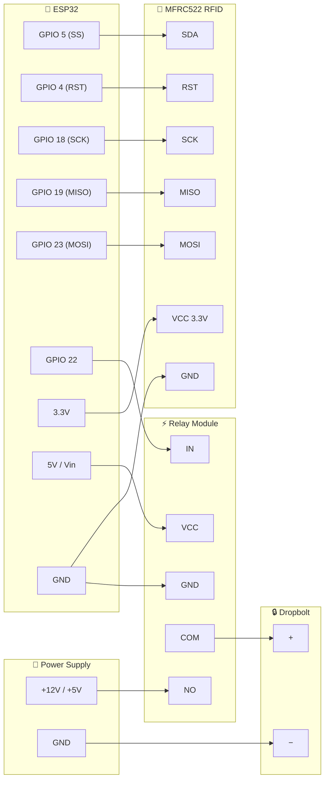
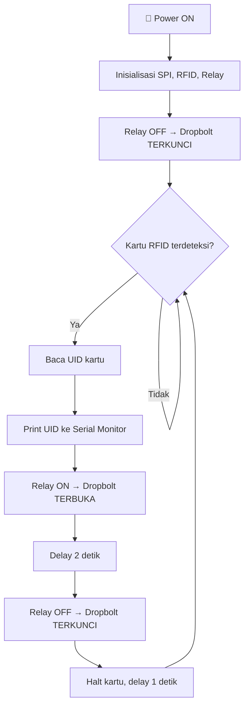

# 📋 Dokumentasi Skema — IoT Prototype: RFID Dropbolt Lock

## 1. Ringkasan Project

Project ini merupakan **prototype sistem kunci pintu (dropbolt) berbasis RFID** menggunakan mikrokontroler **ESP32**. Saat kartu RFID di-tap ke reader, relay akan aktif dan membuka dropbolt selama **2 detik**, lalu mengunci kembali secara otomatis.

> [!NOTE]
> Saat ini masih dalam tahap **testing awal** — belum ada validasi UID (semua kartu bisa membuka kunci).

---

## 2. Komponen Hardware

| No | Komponen | Keterangan |
|----|----------|------------|
| 1 | **ESP32** | Mikrokontroler utama |
| 2 | **MFRC522** | Modul RFID reader (13.56 MHz) |
| 3 | **Relay Module** | 1-channel, active LOW |
| 4 | **Dropbolt Lock** | Kunci elektrik (solenoid) |
| 5 | **Kartu/Tag RFID** | Kartu Mifare / tag NFC |
| 6 | **Power Supply** | Untuk ESP32 & dropbolt |

---

## 3. Wiring / Pin Mapping

### 3.1 RFID MFRC522 → ESP32 (SPI)

| Pin MFRC522 | Pin ESP32 | Keterangan |
|-------------|-----------|------------|
| SDA (SS) | **GPIO 5** | Chip Select |
| SCK | **GPIO 18** | SPI Clock (default HW SPI) |
| MOSI | **GPIO 23** | Master Out Slave In (default HW SPI) |
| MISO | **GPIO 19** | Master In Slave Out (default HW SPI) |
| RST | **GPIO 4** | Reset |
| 3.3V | **3.3V** | Power |
| GND | **GND** | Ground |

> [!CAUTION]
> MFRC522 beroperasi di **3.3V**. Jangan hubungkan ke 5V karena bisa merusak modul.

### 3.2 Relay → ESP32

| Pin Relay | Pin ESP32 | Keterangan |
|-----------|-----------|------------|
| IN | **GPIO 22** | Sinyal kontrol |
| VCC | **5V (Vin)** | Power relay module |
| GND | **GND** | Ground |

### 3.3 Dropbolt → Relay

| Koneksi | Keterangan |
|---------|------------|
| Dropbolt (+) → Relay **COM** | Common relay |
| Power Supply (+) → Relay **NO** | Normally Open |
| Dropbolt (−) → Power Supply (−) | Ground bersama |

---

## 4. Diagram Skema Wiring



---

## 5. Alur Kerja (Flow Program)



---

## 6. Struktur File

```
IoT- Prototype/
├── SKEMA_PROJECT.md          ← Dokumentasi ini
└── test_dropbolt_rfid/
    ├── test_dropbolt_rfid.ino  ← Sketch Arduino utama
    └── arduino.c++             ← Salinan/backup source code
```

> [!NOTE]
> File `arduino.c++` dan `test_dropbolt_rfid.ino` memiliki konten yang **hampir identik** — kemungkinan salah satunya adalah backup atau draft awal.

---

## 7. Konfigurasi Software

| Parameter | Nilai |
|-----------|-------|
| **Board** | ESP32 (e.g. ESP32 Dev Module) |
| **Baud Rate** | 115200 |
| **Library** | `SPI.h`, `MFRC522.h` |
| **Relay Mode** | Active LOW (`RELAY_ACTIVE_LOW = true`) |
| **Unlock Duration** | 2000 ms (2 detik) |
| **Anti-double-trigger Delay** | 1000 ms (1 detik) |

---

## 8. Catatan Penting

> [!WARNING]
> **Belum ada validasi UID** — Setiap kartu RFID yang di-tap akan membuka kunci. Untuk production, tambahkan daftar UID yang diizinkan (whitelist).

### Fitur yang Sudah Ada ✅
- [x] Baca kartu RFID dan print UID ke Serial Monitor
- [x] Kontrol relay untuk buka/tutup dropbolt
- [x] Anti double-trigger delay
- [x] Support relay active LOW & active HIGH

### Fitur yang Belum / Perlu Ditambahkan 🔲
- [ ] **Whitelist UID** — Validasi kartu yang boleh akses
- [ ] **Logging ke SD Card / Cloud** — Catat siapa yang tap & kapan
- [ ] **Buzzer / LED indikator** — Feedback visual/audio saat tap
- [ ] **WiFi / MQTT** — Monitoring & kontrol jarak jauh
- [ ] **Multiple door support** — Satu ESP32 untuk beberapa pintu
- [ ] **Enrollment mode** — Daftarkan kartu baru via Serial/Web

---

## 9. Cara Upload ke ESP32

1. Install **Arduino IDE** dan tambahkan board ESP32
2. Install library **MFRC522** via Library Manager
3. Pilih board: `ESP32 Dev Module`
4. Pilih port COM yang sesuai
5. Buka file `test_dropbolt_rfid.ino`
6. Klik **Upload** (→)
7. Buka **Serial Monitor** (baud: 115200) untuk melihat output

---

*Dokumen ini dibuat: 23 September 2026*
