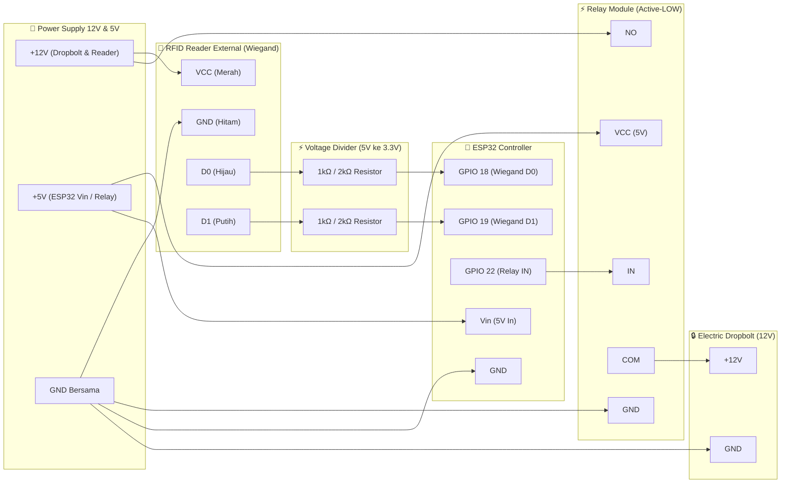
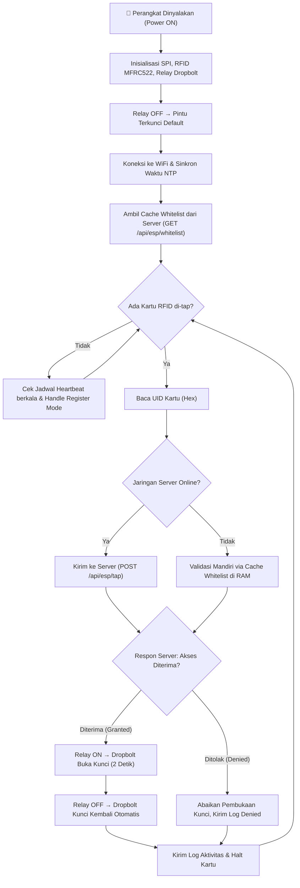

# 📋 Dokumentasi Skema — IoT Prototype: RFID Dropbolt Lock

## 1. Ringkasan Project

Project ini merupakan **sistem kunci pintu otomatis (dropbolt) berbasis RFID IoT** menggunakan mikrokontroler **ESP32**. Sistem ini terhubung langsung ke server lokal (FastAPI) melalui jaringan WiFi untuk melakukan validasi kartu, pelaporan status real-time, dan audit log.

- **Mekanisme Kunci**: Saat kartu RFID yang diizinkan di-tap ke reader MFRC522, relay active-LOW akan aktif dan menarik dropbolt selama **2 detik** (status pintu UNLOCK), lalu mengunci kembali secara otomatis (LOCK).
- **Dual Validation (Online & Offline)**:
  - **Online**: ESP32 mengirim permintaan verifikasi ke server lokal melalui protokol HTTP REST.
  - **Offline (Failover)**: Jika koneksi WiFi atau server terputus, ESP32 secara cerdas memvalidasi kartu menggunakan cache whitelist lokal yang tersimpan di memori RAM dan jam RTC/NTP.

---

## 2. Komponen Hardware

| No | Komponen | Spesifikasi / Tipe | Keterangan |
|---|---|---|---|
| 1 | **ESP32** | NodeMCU ESP-32S / ESP32 DevKit V1 | Mikrokontroler utama dengan modul WiFi & Bluetooth built-in |
| 2 | **RFID Reader External** | Wiegand-26 / Wiegand-34 Reader (12V DC) | Reader RFID eksternal dengan output kabel Data 0 (D0) dan Data 1 (D1) |
| 3 | **Relay Module** | 1-Channel Relay Module (Active-LOW, 5V) | Saklar elektrik pengontrol arus daya dropbolt |
| 4 | **Dropbolt Lock** | Solenoid / Electric Dropbolt Lock (12V) | Kunci mekanis pintu otomatis |
| 5 | **Kartu/Tag RFID** | Proximity / Mifare (Sesuai Reader) | Kredensial identitas pemegang akses |
| 6 | **Power Supply** | Adaptor DC 12V 2A-3A & Step-Down 5V | Sumber daya dropbolt & reader (12V) dan ESP32 (5V via Vin) |

---

## 3. Wiring / Pin Mapping

### 3.1 RFID Reader External (Wiegand) → ESP32

| Kabel / Pin Reader | Terhubung ke | Keterangan Fungsi |
|---|---|---|
| **VCC (Kabel Merah)** | **+12V Power Supply** | Catu daya operasi reader eksternal (9V - 12V DC) |
| **GND (Kabel Hitam)** | **GND Bersama (Common GND)** | **Wajib digabung** antara GND PSU 12V dan GND ESP32 |
| **D0 / DATA 0 (Kabel Hijau)** | **GPIO 18** ESP32 | Jalur transmisi pulsa data bit 0 (via pembagi tegangan) |
| **D1 / DATA 1 (Kabel Putih)** | **GPIO 19** ESP32 | Jalur transmisi pulsa data bit 1 (via pembagi tegangan) |
| **LED / BEEP (Opsional)** | **GPIO Bebas** (Opsional) | Kontrol indikator buzzer / lampu pada reader eksternal |

> [!CAUTION]
> **PERINGATAN LEVEL TEGANGAN (PULSA 5V vs ESP32 3.3V)**:
> Output pulsa D0 dan D1 pada reader Wiegand umumnya bertegangan **5V**, sedangkan pin GPIO **ESP32 hanya mentoleransi maksimal 3.3V**.
> 
> Agar pin ESP32 awet dan tidak terbakar akibat *overvoltage*, pasang **Pembagi Tegangan (Voltage Divider)** menggunakan 2 pasang resistor:
> - **Jalur D0 (Hijau)**: D0 Reader ➡️ Resistor **1kΩ** ➡️ **GPIO 18 ESP32** ➡️ Resistor **2kΩ** ➡️ **GND**
> - **Jalur D1 (Putih)**: D1 Reader ➡️ Resistor **1kΩ** ➡️ **GPIO 19 ESP32** ➡️ Resistor **2kΩ** ➡️ **GND**
> 
> *(Atau alternatif: gunakan modul Logic Level Shifter 5V to 3.3V).*

### 3.2 Relay Module → ESP32

| Pin Relay | Pin ESP32 | Keterangan |
|---|---|---|
| **IN** | **GPIO 22** | Sinyal Kontrol Relay (Active-LOW: LOW = Nyala/Unlock, HIGH = Mati/Lock) |
| **VCC** | **5V (Vin)** | Sumber Daya Koil Relay |
| **GND** | **GND** | Ground Bersama |

### 3.3 Dropbolt Lock & Catu Daya Eksternal → Relay

| Jalur Koneksi | Terminal Relay / PSU | Keterangan |
|---|---|---|
| Dropbolt Positif (+) | **COM (Common)** Relay | Jalur arus daya kunci |
| Power Supply Positif (+12V) | **NO (Normally Open)** Relay | Terhubung hanya saat relay aktif |
| Dropbolt Negatif (−) | **GND Power Supply (12V)** | Ground bersama sistem |
| ESP32 GND | **GND Power Supply (12V)** | Common Ground antara ESP32 dan Power Supply |

---

## 4. Diagram Skema Wiring



---

## 5. Alur Kerja Firmware (Program Flow)



---

## 6. Struktur Direktori Firmware

Source code firmware ESP32 diorganisasikan secara modular di dalam folder **`code esp32/`**:

```
code esp32/
├── config.h               # Konfigurasi Pin GPIO, SSID WiFi, IP Server Backend, Durasi
├── wifi_manager.h / .cpp  # Pengelola koneksi WiFi, reconnect otomatis, dan sinkronisasi waktu NTP
├── rfid_handler.h / .cpp  # Pengelola komunikasi SPI dengan modul reader MFRC522
├── relay_control.h / .cpp # Logika pengontrolan relay dropbolt dengan mode active-LOW
├── access_control.h / .cpp# Manajemen cache whitelist di RAM untuk validasi offline failover
├── api_client.h / .cpp    # Komunikasi HTTP REST ke backend (Tap, Whitelist, Heartbeat)
├── test_dropbolt_rfid.ino # File sketch Arduino utama (Loop & Setup)
└── arduino.c++            # Backup salinan source code awal
```

---

## 7. Parameter & Konfigurasi Firmware

| Parameter | Nilai Default | Penjelasan |
|---|---|---|
| **Board Target** | `ESP32 Dev Module` | Tipe board di Arduino IDE / PlatformIO |
| **Baud Rate Serial** | `115200` | Kecepatan serial monitor debugging |
| **Library Utama** | `SPI.h`, `MFRC522.h`, `WiFi.h`, `HTTPClient.h`, `ArduinoJson.h` | Dependensi library yang digunakan |
| **Mode Relay** | Active LOW (`RELAY_ACTIVE_LOW = true`) | Relay menyala saat pin GPIO 22 berlogika LOW |
| **Durasi Buka Kunci** | `2000 ms` (2 detik) | Waktu dropbolt ditarik sebelum mengunci kembali |
| **Anti-Double-Trigger Delay**| `1000 ms` (1 detik) | Jeda waktu pencegahan pembacaan ganda kartu yang sama |
| **Heartbeat Interval** | `30000 ms` (30 detik) | Interval pengiriman sinyal status perangkat ke server |

---

## 8. Status Fitur Hardware & Integrasi

### Fitur yang Sudah Selesai Diimplementasikan ✅
- [x] **Pembacaan Kartu RFID**: Deteksi UID kartu Mifare 13.56 MHz secara stabil.
- [x] **Kontrol Dropbolt**: Pemicuan relay selama 2 detik dengan penguncian otomatis.
- [x] **Validasi Whitelist Terpusat**: Terintegrasi penuh dengan backend FastAPI.
- [x] **Offline Failover**: Tetap dapat membuka pintu meskipun server mati dengan whitelist di RAM.
- [x] **Pencatatan Audit Real-time**: Pengiriman log tap (Granted/Denied) langsung ke server dan dashboard.
- [x] **Pemantauan Kondisi Perangkat (Heartbeat)**: Indikator Online/Offline dan kekuatan sinyal WiFi (dBm).
- [x] **Buka Pintu Jarak Jauh (Remote Unlock)**: Perintah unlock dapat dieksekusi langsung dari web dashboard.
- [x] **Mode Registrasi Kartu Baru**: Pendaftaran kartu baru langsung dari web melalui trigger hardware ESP32.

### Rencana Pengembangan Tambahan (Hardware) 🔲
- [ ] **Indikator Audio & Visual**: Penambahan Buzzer 5V dan LED RGB (Hijau = Granted, Merah = Denied).
- [ ] **Sensor Pintu (Magnetic Door Sensor)**: Mendeteksi apakah daun pintu benar-benar sudah tertutup rapat sebelum dropbolt keluar.
- [ ] **Multi-Door Support**: Pengembangan kontrol beberapa pintu dari satu unit mikrokontroler.

---

## 9. Petunjuk Upload Program ke ESP32

1. Buka **Arduino IDE** (versi 2.0+ disarankan).
2. Pasang board support **ESP32 by Espressif Systems** via *Boards Manager*.
3. Install library pendukung melalui *Library Manager*:
   - `MFRC522 by GithubCommunity`
   - `ArduinoJson by Benoit Blanchon` (versi 6.x atau 7.x)
4. Buka file `code esp32/test_dropbolt_rfid.ino`.
5. Sesuaikan SSID WiFi, Password, dan IP Server laptop Anda pada file `config.h`.
6. Hubungkan kabel USB ESP32 ke laptop, pilih Board: `ESP32 Dev Module` dan Port COM yang terdeteksi.
7. Klik tombol **Upload**.
8. Buka **Serial Monitor** pada kecepatan baud `115200` untuk memantau status inisialisasi hardware dan koneksi jaringan.
