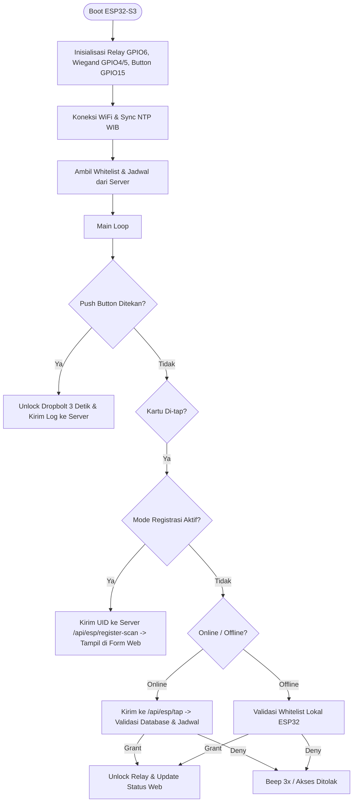

# Access Control ESP32-S3 (test-dev)

Folder ini berisi implementasi firmware ESP32-S3 untuk **Access Control RFID Reader** yang disesuaikan dengan arsitektur backend/web FastAPI pada project ini. 

Kode ini mengadopsi teknik pembacaan Wiegand dari [`template.ino`](../template.ino) (filter lebar pulsa ISR, cek paritas genap/ganjil, debounce tombol, dan isolasi noise relay) lalu menghubungkannya ke REST API & WebSocket server.

---

## 📁 Struktur File

| File | Deskripsi |
|---|---|
| [`test-dev.ino`](test-dev.ino) | File sketch utama Arduino (setup, loop, state machine, audio/visual feedback). |
| [`config.h`](config.h) | Pusat konfigurasi pin hardware, SSID WiFi, IP Server backend, dan konstanta timing. |
| [`wiegand_reader.h`](wiegand_reader.h) / [`.cpp`](wiegand_reader.cpp) | Driver Wiegand26/34 berbasis ISR `CHANGE` dengan filter pulsa (150–1500µs), parity check, dan konversi format UID hex. |
| [`relay_control.h`](relay_control.h) / [`.cpp`](relay_control.cpp) | Kontrol relay dropbolt (active-LOW) non-blocking dengan timer otomatis dan proteksi periode ignore noise (`ignoreUntil`). |
| [`wifi_manager.h`](wifi_manager.h) / [`.cpp`](wifi_manager.cpp) | Modul manajemen koneksi WiFi station, auto-reconnect, dan sinkronisasi waktu NTP (WIB UTC+7). |
| [`api_client.h`](api_client.h) / [`.cpp`](api_client.cpp) | Klien HTTP REST API untuk komunikasi ke server FastAPI (`/api/esp/*`). |
| [`access_control.h`](access_control.h) / [`.cpp`](access_control.cpp) | Manajemen whitelist kartu lokal & jadwal akses offline saat server tidak dapat dijangkau. |

---

## 🔌 Skema Wiring Hardware (ESP32-S3)

> [!WARNING]
> RFID Reader Wiegand beroperasi pada tegangan 12V DC dan menghasilkan sinyal 5V logic pada jalur D0 & D1. **Wajib menggunakan resistor voltage divider** agar pin GPIO ESP32-S3 (3.3V) terlindungi dari tegangan lebih!

### 1. RFID Wiegand Reader
* **VCC (Merah)** $\rightarrow$ +12V DC (Power supply eksternal)
* **GND (Hitam)** $\rightarrow$ GND bersama (Common GND antara adaptor 12V dan ESP32)
* **D0 (Hijau)** $\rightarrow$ Resistor seri 1k $\Omega$ $\rightarrow$ **GPIO 4** $\rightarrow$ Resistor 2k $\Omega$ ke GND
* **D1 (Kuning)** $\rightarrow$ Resistor seri 1k $\Omega$ $\rightarrow$ **GPIO 5** $\rightarrow$ Resistor 2k $\Omega$ ke GND

### 2. Relay Module Dropbolt (Active-LOW)
* **VCC** $\rightarrow$ 5V ESP32 / Adaptor
* **GND** $\rightarrow$ GND
* **IN** $\rightarrow$ Resistor seri 1k $\Omega$ $\rightarrow$ **GPIO 6**  
*(Catatan: Dipindah ke GPIO 6 dari GPIO 38/48 untuk mencegah interferensi dengan LED WS2812B RGB bawaan ESP32-S3)*

### 3. Push Button (Manual Exit)
* **Kaki 1** $\rightarrow$ **GPIO 15** (memakai `INPUT_PULLUP` internal)
* **Kaki 2** $\rightarrow$ GND

---

## ⚙️ Persiapan & Konfigurasi

1. **Library yang Dibutuhkan:**
   * `ArduinoJson` (oleh Benoit Blanchon) — install via Arduino Library Manager.
   * `WiFi` (bawaan board ESP32).

2. **Atur Pengaturan di [`config.h`](config.h):**
   ```cpp
   // WiFi
   #define WIFI_SSID       "Nama_WiFi_Anda"
   #define WIFI_PASSWORD   "Password_WiFi"

   // IP Server FastAPI
   #define SERVER_HOST     "192.168.1.10"   // Ganti dengan IP laptop/server lokal
   #define SERVER_PORT     8000

   // Mode Pengujian
   #define ALLOW_ANY_CARD   false           // Set true jika ingin semua kartu valid langsung membuka relay (mode tes cepat)
   ```

3. **Board Settings di Arduino IDE:**
   * Board: `ESP32S3 Dev Module`
   * USB CDC On Boot: `Enabled` (jika menggunakan port USB Native)
   * Upload Speed: `921600`

---

## 🚀 Alur Kerja Sistem


