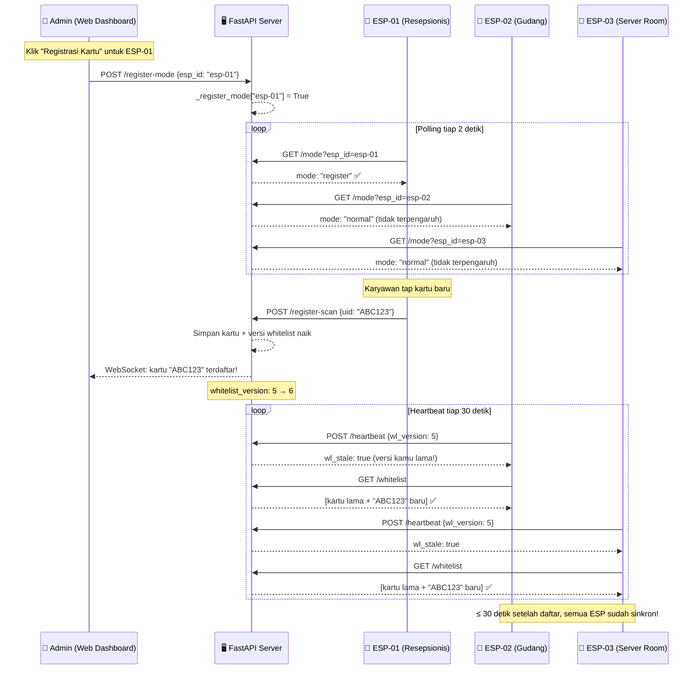

# 📊 Analisa Arsitektur Multi-ESP32: Registrasi Kartu & Sinkronisasi

## Pertanyaan User
> Saya mau daftarkan kartu di 1 ESP32 saja, lalu kartu itu langsung dikenali oleh semua ESP32 lainnya. Apakah sistem ini sudah mendukung itu?

---

## ✅ Yang Sudah Jalan (Tidak Perlu Diubah)

### 1. Kartu Bersifat Global — Semua Pintu Bisa Baca
Tabel `cards` di database **TIDAK terikat ke pintu/ESP manapun**. Begitu kartu didaftarkan, kartu itu milik seluruh sistem.

```
┌────────── Tabel cards ──────────┐
│ uid │ card_holder │ access_level│  ← Tidak ada kolom door_id!
│ ABC │ Budi        │ Karyawan    │
│ DEF │ Rina        │ admin       │
└─────────────────────────────────┘
```

### 2. Semua ESP32 Mendapat Whitelist yang Sama
Endpoint `GET /api/esp/whitelist` mengembalikan **SEMUA kartu aktif** tanpa memfilter berdasarkan `esp_id`:

```sql
-- Query di server (esp.py baris 123):
SELECT uid, access_level, is_active FROM cards WHERE is_active = 1
-- ↑ Tidak ada WHERE esp_id = ... atau WHERE door_id = ...
```

**Artinya:** Kartu yang didaftarkan di ESP-01, otomatis muncul di whitelist ESP-02, ESP-03, dst.

### 3. Validasi Lokal Instan (< 5 ms)
Setiap ESP32 menyimpan salinan whitelist di **RAM + NVS Flash**. Validasi kartu dilakukan secara lokal tanpa perlu kontak server. Ini sudah benar.

---

## ⚠️ 3 Masalah yang Perlu Diperbaiki

### Masalah 1: Delay 5 Menit Setelah Daftar Kartu Baru

**Skenario Bermasalah:**
```
09:00:00  Admin daftarkan kartu "Budi" via web dashboard
09:00:01  Kartu masuk ke database server ✅
09:00:02  Budi tap kartu di ESP-02... ❌ DITOLAK!
          (ESP-02 belum tahu kartu baru, sync berikutnya 5 menit lagi)
09:05:00  ESP-02 sync whitelist dari server...
09:05:01  Budi tap kartu di ESP-02... ✅ DITERIMA
```

> [!WARNING]
> Setelah kartu didaftarkan, semua ESP32 baru mengenali kartu tersebut **setelah siklus sync 5 menit berikutnya** (`WHITELIST_SYNC_MS = 300000`). Tidak ada mekanisme server-push ke ESP32.

**Solusi:** Tambahkan sistem "versi whitelist" di heartbeat. Server menyimpan counter versi yang naik setiap ada perubahan kartu. Saat ESP32 kirim heartbeat tiap 30 detik, server cek: *"versi whitelist kamu masih lama, sync sekarang!"* → ESP32 langsung tarik whitelist baru.

### Masalah 2: Mode Registrasi Aktif di SEMUA ESP32 Sekaligus

**Skenario Bermasalah:**
```
Admin klik "Registrasi Kartu" di dashboard (target: ESP-01 di meja resepsionis)
  → Server set variabel global: _register_mode = True
  → SEMUA ESP32 polling /api/esp/mode → SEMUA masuk mode registrasi!
  → Budi tap kartu di ESP-03 (pintu gudang) → ESP-03 kirim UID ke server!
  → Server terima UID dari ESP-03, bukan dari ESP-01 yang dimaksud!
```

> [!WARNING]
> `_register_mode` adalah satu variabel boolean global. Tidak ada cara memilih ESP mana yang masuk mode registrasi.

**Solusi:** Ubah `_register_mode` dari `bool` menjadi `dict` yang menyimpan `esp_id` target:
```python
# Sebelum (Global):
_register_mode = True

# Sesudah (Per-ESP):
_register_mode = {"esp-01": True}  # Hanya ESP-01 yang masuk register mode
```

### Masalah 3: Tidak Ada Filter Kartu Per Pintu (Opsional)

Saat ini **semua kartu bisa membuka semua pintu**. Ini cocok jika:
- Semua karyawan boleh akses semua ruangan → ✅ Tidak perlu diubah.

Tapi jika nanti butuh aturan seperti:
- *"Kartu OB hanya bisa buka Pintu Gudang, tidak bisa buka Pintu Server Room"*

Maka perlu ditambahkan tabel relasi `card_doors` (many-to-many). **Untuk sekarang ini OPSIONAL, bisa dikerjakan belakangan.**

---

## 📋 Rencana Perbaikan (Urutan Prioritas)

| # | Perbaikan | Dampak | Kompleksitas |
|---|-----------|--------|-------------|
| **1** | Tambah sistem "versi whitelist" di heartbeat agar sync instan | Kartu baru langsung dikenali ≤ 30 detik | Sedang |
| **2** | Ubah register mode jadi per-ESP | Admin bisa pilih ESP mana yang scan kartu baru | Mudah |
| **3** | *(Opsional)* Tabel `card_doors` untuk filter kartu per pintu | Kontrol akses granular per ruangan | Berat |

---

## Alur Registrasi Kartu yang Diinginkan (Setelah Perbaikan)


