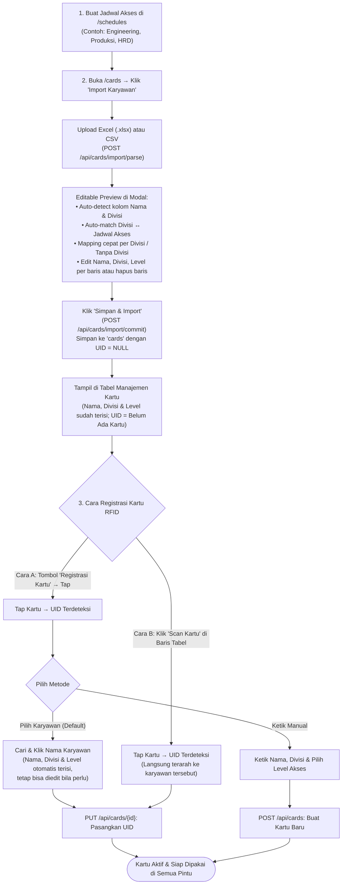

# 📋 PLANNING PROJECT: Import Data Karyawan (Excel/CSV), Pemetaan Jadwal & Registrasi Kartu RFID

**Tanggal**: 25 November 2026 *(Revisi 4 — Support `.xlsx` & `.csv`, Column Mapping, Auto-Match Divisi↔Jadwal & Editable Preview)*  
**Dokumen**: Spesifikasi & Rencana Pengembangan Fitur (*Feature Planning Document*)  
**Status**: ✅ **Selesai Diimplementasikan & Terverifikasi**  
**Versi Target**: v1.2.0  
**Ruang Lingkup**: Server FastAPI + SQLite + Web Dashboard *(Firmware ESP32 tidak perlu di-flash ulang)*

---

## 1. Alur Kerja Utama (End-to-End Workflow)

Sistem dirancang mengikuti urutan kerja paling praktis untuk admin di lapangan — **tanpa perlu mengedit file Excel HRD** dan **tanpa perlu memilih level akses satu per satu saat tap kartu**:

1. **Langkah 1 — Buat Jadwal Akses (`/schedules`)**
   Admin membuat aturan jadwal akses per divisi terlebih dahulu (misal: `Engineering`, `Produksi`, `HRD`, `Office`, dll. — ditambah level bawaan `admin` 24/7).
2. **Langkah 2 — Upload Excel (`.xlsx`) / `.csv` → Editable Preview → Import (`/cards`)**
   - Admin upload file Excel asli (`.xlsx`) atau `.csv` di Modal Import.
   - Sistem otomatis mendeteksi kolom *Nama Karyawan* & *Divisi* (bisa diganti manual jika nama kolom Excel berbeda; kolom lain seperti No/NIK/Jabatan otomatis diabaikan), otomatis membuka *merge cell* vertikal, dan **otomatis mencocokkan Divisi dengan Jadwal Akses yang namanya sama** (*case-insensitive*).
   - Sebelum disimpan, muncul **Editable Preview** sehingga admin bisa langsung:
     - Memetakan level akses cepat per divisi (termasuk kelompok `(Tanpa Divisi)` jika ada divisi kosong).
     - Mengedit langsung **Nama Karyawan**, melengkapi **Divisi kosong**, mengganti **Level Akses per orang** (misal mengubah 1 manajer jadi `admin`), atau **menghapus baris** yang tidak perlu (misal baris footer/resign).
   - Klik **Simpan & Import** → seluruh karyawan masuk ke tabel **Manajemen Kartu** dengan `Nama Karyawan`, `Divisi`, dan `Level Akses` **sudah terisi lengkap** — tinggal kolom `UID` yang masih berstatus *Belum Ada Kartu*.
3. **Langkah 3 — Tap Kartu RFID & Pasangkan ke Nama Karyawan (`/cards`)**
   Registrasi kartu fleksibel dengan **3 cara**:
   - **Cara A — Registrasi Kartu → Tap → Cari Nama Karyawan**: Tap kartu di reader → ketik cari nama karyawan yang belum punya kartu → Nama, Divisi, dan Level Akses otomatis terisi (tetap bisa diedit bila perlu) → klik **Simpan** (atau **Simpan & Scan Berikutnya** untuk registrasi massal).
   - **Cara B — Scan Langsung dari Baris Tabel**: Klik tombol **`Scan Kartu`** langsung di baris karyawan pada tabel → tap kartu → UID langsung terpasang.
   - **Cara C — Ketik Manual**: Tetap bisa mengetik Nama Karyawan, Divisi, dan memilih Level Akses secara bebas jika karyawan belum diimpor (atau untuk kartu tamu).

> **Catatan Istilah & Kolom**:
> - `Nama Pemegang` diganti menjadi **`Nama Karyawan (Employee Name)`**.
> - Ditambahkan kolom **`Divisi (Division)`**.
> - *(Kolom Badge ID ditiadakan sesuai arahan).*

---

## 2. Desain & Migrasi Database (Single Unified Table)

### Mengapa Memakai 1 Tabel Terpadu (`cards` dengan `uid` Nullable)?
Karena karyawan hasil import sudah memiliki `Nama Karyawan`, `Divisi`, dan `Level Akses` dan **hanya menunggu pengisian `UID`**, menyimpan semua data dalam 1 tabel `cards` (dengan `uid TEXT UNIQUE` nullable) jauh lebih bersih dibanding memisahkan 2 tabel:
- **Zero duplikasi & zero desync**: Tidak perlu sinkronisasi bolak-balik antar 2 tabel saat edit nama, divisi, atau level akses.
- **Cascade Rename Jadwal otomatis bekerja**: Mengubah nama jadwal di `/schedules` otomatis ikut memperbarui karyawan yang belum punya kartu maupun yang sudah punya kartu.
- **Satu tabel utuh di UI**: Filter (*Semua / Sudah Ada Kartu / Belum Ada Kartu*), pencarian, edit, hapus, dan bulk update per divisi berjalan di satu tempat.
- **Aman untuk SQLite `UNIQUE`**: Constraint `uid TEXT UNIQUE` (tanpa `NOT NULL`) di SQLite mengizinkan banyak baris dengan `uid = NULL`, sambil tetap menjamin UID fisik yang sudah terisi tidak pernah duplikat.

### A. Migrasi Tabel: `cards`
```sql
-- Skema target tabel cards
CREATE TABLE IF NOT EXISTS cards (
    id INTEGER PRIMARY KEY AUTOINCREMENT,
    uid TEXT UNIQUE,                     -- NULL jika hasil import & belum di-tap kartu RFID
    card_holder TEXT NOT NULL,           -- Nama Karyawan (tetap memakai nama kolom card_holder di DB untuk kompatibilitas 100%)
    division TEXT,                       -- Divisi / Departemen (boleh NULL jika belum diisi)
    access_level TEXT NOT NULL,          -- Level akses / nama jadwal (sudah terisi sejak import)
    is_active INTEGER NOT NULL DEFAULT 1,
    created_at DATETIME NOT NULL,
    updated_at DATETIME NOT NULL
);

CREATE INDEX IF NOT EXISTS idx_cards_uid ON cards(uid);
CREATE INDEX IF NOT EXISTS idx_cards_division ON cards(division);
```
> **Migrasi Aman di `init_db()`**:
> - Memeriksa `PRAGMA table_info(cards)`. Jika `uid` masih `NOT NULL` atau kolom `division` belum ada, dilakukan migrasi atomik (`cards_new` → salin seluruh data & `id` lama → `DROP TABLE cards` → `RENAME`).
> - Kolom `card_holder` tetap menjadi *single source of truth* di DB, sementara API response mengembalikan `employee_name` (bernilai sama dengan `card_holder`) dan UI melabelinya **Nama Karyawan**.

### B. Migrasi Tabel: `access_logs`
```sql
ALTER TABLE access_logs ADD COLUMN division TEXT;
```

---

## 3. Spesifikasi Import Excel (`.xlsx`) & CSV dengan Editable Preview

### A. Format File yang Didukung
1. **Excel Asli (`.xlsx`)** menggunakan `openpyxl` *(ditambahkan ke `server/requirements.txt`)*:
   - Mendukung file multi-sheet (admin bisa memilih sheet jika >1 sheet).
   - Otomatis menangani **Merge Cell** (misal divisi digabung vertikal untuk beberapa baris → otomatis tersalin ke semua baris di dalamnya).
   - Otomatis mendeteksi **baris header** meskipun baris 1–3 berisi kop/judul perusahaan (tetap bisa diubah manual jika perlu).
2. **CSV (`.csv`)**:
   - Encoding `utf-8-sig` (aman dari UTF-8 BOM Microsoft Excel), fallback `latin-1`.
   - Deteksi otomatis delimiter koma (`,`) dan titik koma (`;`).
3. **Template Resmi (`template_karyawan.xlsx` / `.csv`)**:
   - Tetap disediakan tombol **Unduh Template** bagi admin yang ingin memulai dari file kosong.

### B. Auto-Detect Kolom & Penanganan Sel Kosong
- **Pilih Kolom Fleksibel (*Column Mapping*)**:
  - Kolom **Nama Karyawan** *(wajib)*: auto-detect header mengandung `employee_name`, `nama_karyawan`, `nama karyawan`, `nama lengkap`, `nama`, `name`.
  - Kolom **Divisi** *(opsional)*: auto-detect header mengandung `division`, `divisi`, `departemen`, `department`, `dept`, `bagian`.
  - Kolom **Level Akses** *(opsional)*: auto-detect header mengandung `access_level`, `level_akses`, `level`, `jadwal`.
  - Kolom lain (misal `No`, `NIK`, `Jabatan`, `Email`, `Tanggal Masuk`) **otomatis diabaikan** — file Excel HRD tidak perlu diubah.
- **Penanganan Baris & Kolom Kosong**:
  - **Divisi kosong, Nama terisi**: Tidak error; tetap masuk preview dengan Divisi kosong dan dikelompokkan ke **`(Tanpa Divisi)`** di panel mapping level (dan tetap bisa diisi manual di tabel preview maupun nanti lewat tombol Edit).
  - **Baris benar-benar kosong**: Otomatis dilewati (*skip*) tanpa dianggap error.
  - **Nama kosong tapi ada sel lain terisi**: Otomatis dilewati dan dilaporkan sebagai catatan warning di preview.

### C. Auto-Match Divisi ↔ Jadwal + Editable Preview (2 Tahap API)
Alur teknis import menggunakan pola **2 tahap (`parse` → `edit di preview` → `commit`)** agar apa yang dilihat dan diedit user di preview **100% persis** dengan yang masuk ke database:

1. **Tahap 1 — `POST /api/cards/import/parse`**:
   - Upload file `.xlsx`/`.csv` (beserta parameter opsional `sheet_name`, `header_row`, `name_col`, `division_col`, `level_col`).
   - Backend mem-parsing seluruh baris, mengecek duplikat terhadap DB existing, dan **otomatis mencocokkan `division` dengan jadwal di tabel `schedules`** (*case-insensitive*):
     - Jika divisi `Engineering` cocok dengan jadwal `Engineering` → `access_level` baris tersebut otomatis terisi `Engineering` (`auto_matched = true`).
     - Jika divisi belum punya jadwal bernama sama (atau kosong) → `access_level = ""` agar admin memilih di panel mapping cepat atau per baris.
   - Mengembalikan JSON daftar sheet, daftar header kolom, kolom terpilih, dan seluruh array `rows` ke Modal Import.
2. **Tahap 2 — Edit Bebas di Modal Import (Frontend)**:
   - **Panel Mapping Cepat per Divisi** (di atas tabel preview):
     - Menampilkan setiap divisi unik beserta jumlah orangnya (misal `Engineering (12)`, `Produksi (35)`, `(Tanpa Divisi) (3)`).
     - Mengubah dropdown level pada satu divisi langsung mengisi/memperbarui kolom `Level Akses` semua baris di divisi tersebut pada tabel preview.
   - **Tabel Editable Preview**:
     - Menampilkan seluruh baris hasil parsing (scrollable + kotak pencarian/filter cepat di dalam preview):
       `#` | `Nama Karyawan (input edit)` | `Divisi (input edit)` | `Level Akses (dropdown edit)` | `Status` | `Hapus Baris`
     - Admin bisa langsung:
       - Memperbaiki typo nama atau mengisi divisi yang kosong.
       - Mengubah `Level Akses` khusus untuk 1 orang tertentu (misal ubah 1 manajer divisi Engineering menjadi `admin`).
       - Menghapus baris yang tidak diinginkan (misal baris catatan/footer atau karyawan resign).
     - Indikator status tiap baris:
       - 🟢 **Siap**: Nama & Level Akses valid, bukan duplikat.
       - 🟡 **Perlu Level**: Nama valid, Level Akses belum dipilih.
       - 🟠 **Duplikat**: Kombinasi Nama + Divisi sudah ada di DB atau ganda di preview (otomatis tidak ikut disimpan kecuali diedit/dihapus).
3. **Tahap 3 — `POST /api/cards/import/commit`**:
   - Tombol **"Simpan & Import X Karyawan"** aktif jika ada minimal 1 baris siap dan tidak ada baris valid yang level aksesnya masih kosong.
   - Mengirim array JSON baris final yang sudah diedit ke backend → backend validasi ulang & batch insert atomik ke tabel `cards` dengan **`uid = NULL`**.

---

## 4. Diagram Alur Sistem (Mermaid)



---

## 5. Aturan Lifecycle & Keamanan Data

| Skenario | Perilaku Sistem |
| :--- | :--- |
| **Registrasi Mode Pilih Nama (`PUT /api/cards/{id}`)** | Memasangkan `uid` (uppercase) ke baris karyawan yang sebelumnya `uid = NULL`. Validasi UID belum dipakai baris lain (`409 Conflict`). Nama, Divisi, dan Level Akses tetap bisa diubah/dilengkapi sekaligus saat simpan. |
| **Registrasi Mode Ketik Manual (`POST /api/cards`)** | Membuat baris baru dengan `uid` langsung terisi (atau `uid = NULL` jika tambah karyawan satuan sebelum punya kartu). Validasi UID unik jika terisi. |
| **Kartu Hilang / Rusak → "Lepas Kartu" (`POST /api/cards/{id}/unlink`)** | Mengosongkan `uid = NULL` pada baris tersebut. Kartu lama langsung tidak bisa membuka pintu, sementara Nama Karyawan, Divisi, dan Level Akses tetap tersimpan — siap langsung di-tap kartu pengganti. |
| **Hapus Baris (`DELETE /api/cards/{id}`)** | Menghapus permanen data karyawan/kartu dari database. |
| **Ubah Level Massal per Divisi (`PUT /api/cards/bulk-level`)** | Mengubah `access_level` seluruh baris dalam 1 divisi sekaligus dalam 1 klik. |
| **ESP32 Whitelist (`GET /api/esp/whitelist`)** | Hanya mengambil kartu ber-UID yang aktif: `WHERE is_active = 1 AND uid IS NOT NULL AND uid != ''`. Karyawan belum punya kartu **tidak** dikirim ke ESP32 sehingga tidak memakan kuota `MAX_CARDS = 200`. |
| **Dashboard Overview (`GET /api/dashboard/stats`)** | `total_cards` & `active_cards` menghitung kartu ber-UID, ditambah `unassigned_cards` untuk jumlah karyawan yang belum punya kartu. |
| **Validasi Jadwal Case-Insensitive (`esp.py`)** | Memperbaiki query `_check_schedule()` menjadi `WHERE LOWER(access_level) = LOWER(?) AND is_active = 1` dan pengecekan `access_level.lower() != "admin"` agar selaras dengan `strcasecmp` di ESP32. |

---

## 6. Rencana Perubahan Backend (FastAPI)

### A. Dependencies (`server/requirements.txt`)
- Tambahkan `openpyxl==3.1.5` (pure Python, ringan, untuk membaca `.xlsx` & merged cells).

### B. `server/database.py`
- Migrasi aman tabel `cards`: jadikan `uid` nullable (`TEXT UNIQUE`) dan tambahkan kolom `division TEXT` + index `idx_cards_division`.
- Migrasi tabel `access_logs`: tambahkan kolom `division TEXT`.

### C. `server/models.py`
- Update `CardCreate`: `uid: Optional[str] = None`, `card_holder: Optional[str] = None`, `employee_name: Optional[str] = None`, `division: Optional[str] = None`, `access_level: str`.
- Update `CardUpdate`: tambah `uid: Optional[str] = None`, `employee_name: Optional[str] = None`, `division: Optional[str] = None`.
- Update `CardResponse`: `id`, `uid: Optional[str]`, `card_holder`, `employee_name`, `division: Optional[str]`, `access_level`, `is_active`, `created_at`, `updated_at`.
- Tambah model import & bulk: `CardImportItem`, `CardImportCommitRequest`, `CardImportResult`, `BulkLevelUpdate`.
- Update `AccessLogResponse`: tambah `employee_name: Optional[str] = None` dan `division: Optional[str] = None`.

### D. `server/routers/cards.py`
| Endpoint | Method | Role | Keterangan |
| :--- | :---: | :---: | :--- |
| `/api/cards` | `GET` | `owner`, `admin`, `viewer` | List kartu & karyawan. Filter: `search` (nama/divisi/UID), `division`, `access_level`, `is_active`, `card_status` (`all` \| `registered` \| `unassigned`), `page`, `per_page` |
| `/api/cards/count` | `GET` | `owner`, `admin`, `viewer` | Hitung total sesuai seluruh filter di atas |
| `/api/cards/divisions` | `GET` | `owner`, `admin`, `viewer` | Daftar divisi unik (untuk dropdown filter & autocomplete) |
| `/api/cards/unassigned` | `GET` | `owner`, `admin` | Daftar ringkas semua karyawan yang `uid IS NULL` untuk pencarian cepat di Modal Registrasi |
| `/api/cards/template` | `GET` | `owner`, `admin` | Unduh template file (`format=xlsx` atau `format=csv`) |
| `/api/cards/import/parse` | `POST` | `owner`, `admin` | Parse file `.xlsx`/`.csv`, auto-detect kolom & header, unmerge cell, auto-match `division` ↔ jadwal, tandai duplikat → return JSON untuk Editable Preview |
| `/api/cards/import/commit` | `POST` | `owner`, `admin` | Simpan array baris hasil preview yang sudah diedit user secara atomik ke `cards` (`uid = NULL`) |
| `/api/cards/bulk-level` | `PUT` | `owner`, `admin` | Ubah level akses massal untuk semua baris dalam satu divisi |
| `/api/cards` | `POST` | `owner`, `admin` | Tambah kartu (mode manual) atau tambah karyawan satuan tanpa kartu (`uid = null`) |
| `/api/cards/{id}` | `PUT` | `owner`, `admin` | Edit nama, divisi, level akses, status aktif, atau pasangkan `uid` |
| `/api/cards/{id}/unlink` | `POST` | `owner`, `admin` | Lepas kartu (`uid = NULL`) tanpa menghapus data karyawan |
| `/api/cards/{id}` | `DELETE` | `owner`, `admin` | Hapus permanen baris karyawan/kartu |

> **Catatan urutan route FastAPI**: Seluruh route statis (`/count`, `/levels`, `/divisions`, `/unassigned`, `/template`, `/import/parse`, `/import/commit`, `/bulk-level`) didaftarkan **di atas** route dinamis `/{card_id}`.

### E. `server/routers/esp.py`, `doors.py`, `logs.py`, `main.py`
- **`esp.py`**: Filter `AND uid IS NOT NULL AND uid != ''` di `get_whitelist()`; kirim `existing_division` di `handle_register_scan()`; simpan & broadcast `division` pada online & offline tap; ubah `_check_schedule()` dan cek `admin` menjadi **case-insensitive**.
- **`doors.py`**: Sertakan kolom `division` pada `INSERT INTO access_logs` & broadcast WebSocket di `remote_unlock()`.
- **`logs.py`**: Perluas `search` agar mencakup `division`; kembalikan `division` & `employee_name`; perbaiki `export_logs_csv` memakai `csv.writer` + UTF-8 BOM (`\ufeff`) dengan kolom: `Timestamp`, `UID`, `Nama Karyawan`, `Divisi`, `Access Level`, `Status`, `Alasan Denied`, `Pintu`.
- **`main.py`**: Update `GET /api/dashboard/stats` agar `total_cards`/`active_cards` hanya menghitung kartu ber-UID, tambah `unassigned_cards`, dan sertakan `division` & `employee_name` di `recent_logs`.

---

## 7. Rencana Perubahan Tampilan Dashboard (Frontend)

### A. Halaman Manajemen Kartu (`server/static/cards.html`)
1. **Header & Tombol Aksi**:
   - Tombol **"Import Karyawan"** (Excel/CSV), tombol **"Tambah Karyawan"** *(satuan)*, dan tombol utama **"Registrasi Kartu"**.
2. **Filter Cepat Status Kartu + Pencarian**:
   - Filter pill: **`Semua`** | **`Sudah Ada Kartu`** | **`Belum Ada Kartu`** (dengan badge jumlah).
   - Search bar `"Cari nama karyawan / divisi / UID..."` memakai **`encodeURIComponent()`** (aman untuk divisi mengandung `&` seperti `Finance & Accounting`).
   - Dropdown filter `Divisi`, `Level Akses`, `Status Aktif`, + tombol **"Ubah Level per Divisi"** (bulk action).
3. **Tabel Terpadu**:
   - Kolom: `UID` | `Nama Karyawan` | `Divisi` | `Level Akses` | `Status` | `Aksi`.
   - Kolom `Divisi` ditampilkan apa adanya (**tanpa** CSS `capitalize` agar singkatan `IT`, `HRD`, `QC` tidak berubah).
   - Baris tanpa UID menampilkan badge **`Belum Ada Kartu`**, status **`Menunggu Kartu`**, dan tombol cepat **`Scan Kartu`** di kolom Aksi.
   - Baris ber-UID memiliki tombol **`Edit`**, **`Lepas Kartu`**, dan **`Hapus`**.
4. **Modal Import Karyawan (Excel/CSV + Editable Preview)**:
   - Modal lebar (`max-w-4xl`) agar nyaman diedit seperti tabel mini:
     - **Area Upload**: pilih/drag-and-drop `.xlsx` atau `.csv` + tombol **Unduh Template (.xlsx / .csv)**.
     - **Bar Pengaturan Sheet & Kolom**: pilihan Sheet *(jika Excel >1 sheet)*, Baris Header, Kolom Nama, dan Kolom Divisi *(semuanya auto-detect, bisa diganti & langsung re-parse)*.
     - **Panel Mapping Cepat per Divisi**: otomatis menampilkan status `✓ Cocok otomatis` untuk divisi yang sama dengan jadwal, serta dropdown pilih cepat untuk divisi lain & `(Tanpa Divisi)`.
     - **Tabel Editable Preview**: kotak filter/cari baris di dalam preview + input langsung untuk **Nama Karyawan**, **Divisi**, dropdown **Level Akses**, badge status (`Siap` / `Perlu Level` / `Duplikat`), dan tombol **Hapus Baris (🗑️)**.
     - **Footer**: ringkasan jumlah (*X siap diimpor, Y duplikat dilewati, Z perlu pilih level*) + tombol **"Simpan & Import X Karyawan"**.
5. **Modal Registrasi Kartu (Scan Mode)**:
   - Jika dipicu dari **`Scan Kartu` di baris tabel**: langsung mengarah ke karyawan target; begitu kartu di-tap langsung siap konfirmasi/edit & simpan.
   - Jika dipicu dari tombol **`Registrasi Kartu`**: toggle **Pilih Nama Karyawan** *(searchable, default jika ada data belum ber-UID)* vs **Ketik Manual** *(auto-fallback jika semua sudah punya kartu)*. Nama, Divisi, dan Level Akses yang terisi otomatis tetap bisa diedit sebelum simpan. Dilengkapi tombol **`Simpan Kartu`** dan **`Simpan & Scan Berikutnya`**.
6. **Modal Edit Kartu & Modal Tambah Karyawan**:
   - Mendukung edit/input `Nama Karyawan`, `Divisi` (dengan datalist saran divisi), `Level Akses`, dan `Status Aktif`.

### B. Halaman Log Akses (`server/static/logs.html`)
- Pertahankan kolom `UID` (penting untuk audit kartu tak terdaftar).
- Kolom tabel: `Waktu` | `UID` | `Nama Karyawan & Divisi` | `Level Akses` | `Pintu` | `Status Akses`.
- Pencarian mencakup Nama, Divisi, dan UID (dengan `encodeURIComponent()`).

### C. Halaman Dashboard Utama (`server/static/index.html`)
- Live feed **Aktivitas Terkini**: tampilkan `Nama Karyawan`, `Divisi` (jika ada), dan `UID` secara konsisten baik dari initial load maupun WebSocket.

---

## 8. Analisis Dampak Firmware ESP32

> [!IMPORTANT]
> **FIRMWARE ESP32 TIDAK PERLU DIUBAH ATAU DI-FLASH ULANG!**
> 1. ESP32 hanya mengirim `uid`, `esp_id`, `door_name` saat tap kartu.
> 2. Server memutuskan `grant`/`deny` serta mencatat Nama Karyawan & Divisi.
> 3. `/api/esp/whitelist` hanya mengirim kartu aktif yang memiliki UID (`uid IS NOT NULL`) dengan format JSON yang sama persis.

> [!NOTE]
> **Catatan Mode Offline ESP32**: Di firmware ESP32 (`access_control.h`), panjang buffer `char accessLevel[12]` maksimal **11 karakter**. Saat **online (server)** panjang nama jadwal bebas; untuk menjamin akurasi **mode offline** tanpa flash ulang firmware, disarankan nama jadwal akses ≤ 11 karakter (contoh: `IT`, `HRD`, `QC`, `Engineering`, `Produksi`, `Finance`, `Shift_Pagi`). Jika nanti ingin nama jadwal lebih panjang saat offline, cukup naikkan `accessLevel[12]` → `accessLevel[32]` saat flash berikutnya.

---

## 9. Tahapan Pengerjaan & Checklist Verifikasi

| Tahap | Modul | Tugas Utama |
| :---: | :--- | :--- |
| **1** | **Dependency, Database & Model** | • Install `openpyxl` di `venv` & tambahkan ke `server/requirements.txt`<br>• Migrasi aman `cards` (`uid` nullable + `division`) & `access_logs` (`division`) di `server/database.py`<br>• Update `server/models.py` |
| **2** | **Backend API** | • Perbarui `server/routers/cards.py` (`/import/parse` `.xlsx`+`.csv`+unmerge+auto-match, `/import/commit`, `/template`, `/unassigned`, `/divisions`, `/bulk-level`, `/{id}/unlink`, filter `card_status`/`division`, assign UID di `PUT /{id}`)<br>• Perbarui `server/routers/esp.py`, `doors.py`, `logs.py`, dan `main.py` |
| **3** | **Frontend `cards.html`** | • Filter cepat status kartu + filter divisi + perbaikan `encodeURIComponent()`<br>• Modal Import `.xlsx`/`.csv` lengkap dengan **pilih sheet/kolom, auto-match divisi↔jadwal, mapping cepat per divisi, dan Tabel Editable Preview**<br>• Pembaruan Modal Registrasi (Pilih Nama + Scan dari baris + Ketik Manual + *Simpan & Scan Berikutnya*), *Lepas Kartu*, Edit, Tambah Karyawan, dan Bulk Ubah Level |
| **4** | **Frontend `logs.html` & `index.html`** | • Tampilkan `Divisi` sambil mempertahankan `UID` di `logs.html`<br>• Tampilkan `Divisi` di live feed `index.html` (initial load + WebSocket) |
| **5** | **Pengujian & Verifikasi** | • Tes upload Excel `.xlsx` (termasuk kolom tambahan HRD, divisi kosong, & merged cells) dan `.csv` (`;`/`,` + UTF-8 BOM)<br>• Tes auto-match `Divisi` ↔ `Jadwal Akses` + edit langsung di tabel preview (ubah nama, isi divisi kosong, override 1 orang jadi `admin`, hapus baris) → commit<br>• Tes registrasi kartu via Cara A (tap → cari nama), Cara B (klik *Scan Kartu* di baris), dan Cara C (ketik manual)<br>• Tes *Lepas Kartu* & pasang kartu pengganti<br>• Tes `/api/esp/whitelist` memastikan karyawan tanpa UID tidak ikut terkirim<br>• Tes tap online/offline → cek `index.html` (termasuk setelah refresh), `logs.html`, dan Export CSV |
