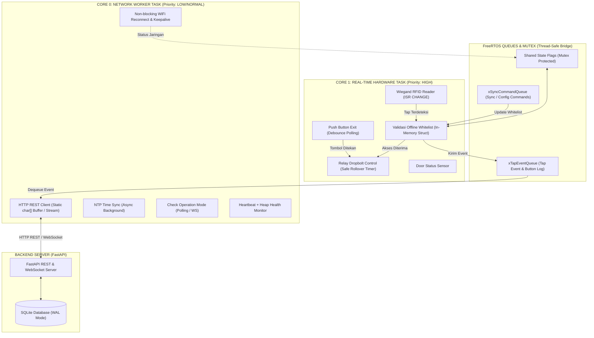

# 📋 Rencana Pembaruan & Refactoring Firmware ESP32-S3 (Access Control 24/7)

> **Dokumen Perencanaan Teknis (Engineering Plan)**  
> **Target Perangkat:** ESP32-S3 Dev Module  
> **Target Direktori:** `code esp32/kode-esp32s3-dev/`  
> **Target Operasional:** Nonstop 24/7/365 (*Mission-Critical Production Grade*)  
> **Terakhir Diperbarui:** 16 November 2026  

---

## 📑 Daftar Isi
1. [Latar Belakang & Identifikasi Masalah](#1-latar-belakang--identifikasi-masalah)
2. [Arsitektur Baru: Dual-Core FreeRTOS](#2-arsitektur-baru-dual-core-freertos)
3. [Daftar Prioritas Migrasi](#3-daftar-prioritas-migrasi)
4. [Rincian Rencana Perubahan Tiap File](#4-rincian-rencana-perubahan-tiap-file)
5. [Panduan Instalasi Proteksi Fisik (Hardware)](#5-panduan-instalasi-proteksi-fisik-hardware)
6. [Fitur Wireless Upload / OTA (Over-The-Air)](#6-fitur-wireless-upload--ota-over-the-air)
7. [Skenario Pengujian & Kriteria Kelayakan (Testing & QA)](#7-skenario-pengujian--kriteria-kelayakan-testing--qa)
8. [Checklist Progress Eksekusi](#8-checklist-progress-eksekusi)

---

## 1. Latar Belakang & Identifikasi Masalah

Berdasarkan audit teknis terhadap firmware prototipe saat ini, ditemukan **5 titik kritis (*bottlenecks / bugs*)** yang menyebabkan perangkat rentan mengalami *freeze*, respon lambat, atau *crash* mendadak saat berjalan nonstop:

1. **Blocking I/O pada Loop Utama:** Request HTTP (`GET /api/esp/mode`) tiap 2 detik dan fungsi `WiFiClient::connect()` menahan CPU selama 3–5 detik jika server mati/offline. Selama CPU tertahan, pembacaan RFID dan Push Button macet total.
2. **Blocking saat WiFi Putus:** `while (WiFi.status() != WL_CONNECTED) delay(500)` di `wifi_manager.cpp` menahan eksekusi hingga 10–15 detik saat koneksi hilang.
3. **Bug `millis()` Rollover di Hari ke-49,7:** Rumus timer di `relay_control.cpp` menggunakan perbandingan langsung `millis() > _unlockUntil`, yang akan rusak ketika register `millis()` meluap (*overflow*) kembali ke 0.
4. **Fragmentasi Memori RAM (Heap Fragmentation):** Pembacaan karakter per karakter menggunakan objek dinamis `String` di `api_client.cpp` memecah RAM ESP32 menjadi potongan-potongan kecil hingga berujung pada *Out Of Memory (OOM) Kernel Panic*.
5. **Belum Ada Watchdog Timer (WDT):** Jika driver WiFi atau stack TCP membeku, perangkat tidak memiliki mekanisme auto-reboot mandiri.

---

## 2. Arsitektur Baru: Dual-Core FreeRTOS

ESP32-S3 memiliki prosesor Dual-Core (Xtensa LX7). Arsitektur baru akan memisahkan domain **Hardware Real-Time** dengan domain **Networking/Background** ke dua core yang berbeda:



### Keunggulan Arsitektur Ini:
* **Zero Latency pada Hardware:** Jika server mati, kabel LAN dicabut, atau WiFi error, respon buka pintu kartu RFID & Push Button tetap instan (< 5 ms).
* **Isolasi Kegagalan (*Fault Isolation*):** Crash atau timeout pada jaringan di Core 0 tidak akan mematikan Core 1.

---

## 3. Daftar Prioritas Migrasi

Perombakan dibagi menjadi 3 tahap prioritas terstruktur:

| Prioritas | Komponen | Estimasi Dampak |
|---|---|---|
| **P1 - Kritis** | • Fix `millis()` Rollover di `relay_control.cpp`<br>• Refactor buffer statis di `api_client.cpp`<br>• Implementasi Dual-Core FreeRTOS & Queue di `test-dev.ino`<br>• Pasang Hardware Watchdog Timer (WDT) | Menghilangkan 100% resiko sistem beku (*freeze*), crash OOM, dan bug hari ke-49,7. |
| **P2 - Penting** | • Non-blocking WiFi Reconnect di `wifi_manager.cpp`<br>• Kirim metrik `getFreeHeap()` & `getMaxAllocHeap()` di Heartbeat | Menjamin pemulihan koneksi mandiri tanpa jeda dan memberikan visibilitas RAM. |
| **P3 - Opsional** | • Aktifkan SQLite WAL Mode di `server/database.py`<br>• Tangkap metrik RAM di `server/models.py` | Optimasi performa database server saat banyak tap bersamaan. |

---

## 4. Rincian Rencana Perubahan Tiap File

### 4.1. `relay_control.h` & `relay_control.cpp`
* **Masalah:** Menggunakan `millis() > _unlockUntil` dan `millis() < _ignoreUntil`.
* **Solusi Perubahan:**
  * Simpan waktu mulai (`_unlockStartMs`, `_ignoreStartMs`) dan durasi (`_unlockDurationMs`, `_ignoreDurationMs`).
  * Gunakan rumus *safe unsigned subtraction*:
    ```cpp
    bool relayIsUnlocked() {
      if (!_isUnlocked) return false;
      if (millis() - _unlockStartMs >= _unlockDurationMs) {
        relayLock();
        return false;
      }
      return true;
    }
    ```
  * Perbaiki fungsi `relayIsIgnoring()` dengan pola yang sama.

### 4.2. `api_client.h` & `api_client.cpp`
* **Masalah:** Menggunakan objek `String` untuk merakit dan membaca respons TCP karakter demi karakter.
* **Solusi Perubahan:**
  * Buang loop `while (client.available()) rawResponse += (char)client.read();`.
  * Gunakan buffer tetap `char httpBuffer[1024]` dengan `client.readBytes()`.
  * Untuk payload JSON (seperti Whitelist): gunakan *Stream Deserialization* `deserializeJson(doc, client)` langsung dari stream socket tanpa alokasi memori ganda.
  * Tetapkan timeout koneksi TCP pendek (`CONNECT_TIMEOUT_MS = 1500`).

### 4.3. `wifi_manager.h` & `wifi_manager.cpp`
* **Masalah:** Loop `while` blocking dengan `delay(500)` saat koneksi gagal.
* **Solusi Perubahan:**
  * Ubah inisialisasi koneksi menjadi asinkron (`WiFi.begin()` tanpa blocking loop).
  * Di dalam task FreeRTOS, gunakan `vTaskDelay(pdMS_TO_TICKS(500))` sebagai pengganti `delay(500)`.
  * Buat flag status koneksi yang thread-safe.

### 4.4. `test-dev.ino`
* **Masalah:** Semua alur (RFID, Tombol, Relay, WiFi, Polling HTTP) bertumpuk dalam satu `loop()` Arduino.
* **Solusi Perubahan:**
  * Buat struktur data `TapEvent` untuk antrean FreeRTOS.
  * Inisialisasi antrean: `QueueHandle_t xTapQueue = xQueueCreate(10, sizeof(TapEvent));`.
  * Buat task FreeRTOS di Core 0:
    ```cpp
    xTaskCreatePinnedToCore(networkTask, "NetWorker", 8192, NULL, 1, &netTaskHandle, 0);
    ```
  * Konfigurasikan Task Watchdog Timer (WDT) dengan batas 15 detik (Dual-Core monitoring):
    * Di Core 1 (`setup`): Daftarkan `loopTask` via `esp_task_wdt_add(NULL)`.
    * Di Core 0 (`networkTask`): Daftarkan `networkTask` via `esp_task_wdt_add(NULL)`.
    * Kompatibilitas ESP-IDF 5 / Arduino-ESP32 3.x menggunakan `esp_task_wdt_reconfigure()`.
  * `loop()` (berjalan di Core 1) hanya berisi:
    1. `esp_task_wdt_reset();`
    2. `relayUpdate();`
    3. `checkPushButton();`
    4. `wiegandCheckCard();` (dan mengirim ke Queue jika ada tap).

### 4.5. `config.h`
* Tambahkan definisi pendukung:
  * `NETWORK_TASK_STACK_SIZE = 8192`
  * `TAP_QUEUE_SIZE = 32`
  * `WDT_TIMEOUT_SEC = 15`
  * Interval penyesuaian heartbeat dan mode check.
  * Kredensial & port OTA (`OTA_HOSTNAME`, `OTA_PASSWORD`, `OTA_PORT = 3232`).

---

## 5. Panduan Instalasi Proteksi Fisik (Hardware)

### Pemasangan Dioda Flyback (1N4007) pada Rangkaian WAGO
Untuk meredam lonjakan *back-EMF* (100V–300V) dari solenoid dropbolt saat relay mati:

```
[ WAGO +12V ] ────────▶ Terminal COM Relay
                         │
                         ▼
                   [ Modul Relay ]
                   Terminal NO/NC ──┬──────────────────────▶ Kabel Merah (+) Dropbolt
                                    │
                            ┌───────┴───────┐
                            │  KATODA (-)   │  <-- Kaki ada GARIS PUTIH/PERAK
                            │ [Garis Putih] │      (dijepit di baut terminal Relay)
                            │    1N4007     │
                            │   ANODA (+)   │
                            └───────┬───────┘
                                    │          <-- Kaki POLOS HITAM
[ WAGO GND  ] ──────────────────────┴──────────────────────▶ Kabel Hitam (-) Dropbolt
  (Negatif)
```

> [!CAUTION]
> **Polaritas Dioda:** Kaki dengan garis cincin putih/perak (Katoda) **WAJIB** terhubung ke jalur positif Dropbolt (Terminal Relay). Jangan terbalik agar tidak terjadi korsleting ke adaptor.

---

## 6. Fitur Wireless Upload / OTA (Over-The-Air)

### 6.1. Pertanyaan Kunci: Apakah Cukup 1 Jaringan atau Wajib IP Fix?
* **Jawabannya:** **CUKUP 1 JARINGAN WIFI YANG SAMA (LAN/WLAN).**
* Anda **TIDAK WAJIB** memiliki IP server statis/fix atau koneksi internet.
* ArduinoOTA menggunakan protokol **mDNS (Multicast DNS)** pada port TCP **3232**. Selama laptop/PC Anda dan ESP32 terhubung ke WiFi/router yang sama, ESP32 akan langsung muncul secara otomatis di Arduino IDE pada menu:
  $$\text{Tools } \rightarrow \text{ Port } \rightarrow \text{ Network ports (misal: esp-01 at 192.168.1.50)}$$
* Anda cukup memilih port jaringan tersebut dan menekan tombol **Upload** seperti biasa.

### 6.2. Cara Kerja Teknis OTA pada ESP32-S3
1. **Dual Application Partitions (`app0` & `app1`):** ESP32 membagi flash memory menjadi dua slot firmware. Firmware yang sedang berjalan ada di `app0`.
2. **Flashing Over WiFi:** File binary baru dikirim lewat WiFi dan ditulis ke `app1`.
3. **Integritas MD5 Checksum:** Setelah selesai, ESP32 memverifikasi checksum MD5. Jika valid, bootloader diarahkan untuk boot dari `app1`. Jika corrupt/terputus, ESP32 otomatis membatalkan dan tetap menjalankan `app0`.
4. **Keamanan (Password OTA):** Port OTA dilindungi password (`OTA_PASSWORD`) agar orang luar di jaringan WiFi tidak bisa membajak pintu.

### 6.3. Penanganan Khusus Saat OTA Berlangsung
* **Relay Safety:** Pada callback `ArduinoOTA.onStart()`, paksa `relayLock()` agar pintu dipastikan terkunci selama update.
* **Watchdog Feeding:** Proses flashing butuh waktu 5–15 detik. Panggil `esp_task_wdt_reset()` di dalam callback `ArduinoOTA.onProgress()` agar Hardware Watchdog tidak me-reboot ESP32 di tengah flashing.

---

## 7. Skenario Pengujian & Kriteria Kelayakan (Testing & QA)

Setelah refactoring selesai, serangkaian pengujian wajib dilakukan:

1. **Uji Server Mati (Offline Stress Test):**
   * *Aksi:* Matikan server FastAPI / matikan laptop.
   * *Kriteria Lolos:* Push Button dan tap kartu RFID lokal tetap merespons seketika (< 10 ms) membuka dropbolt tanpa ada jeda atau freeze.
2. **Uji WiFi Putus-Nyambung (Network Resilience Test):**
   * *Aksi:* Matikan Access Point WiFi selama 1 menit, lalu nyalakan kembali.
   * *Kriteria Lolos:* ESP32 otomatis tersambung kembali (*reconnected*) dan data tap offline yang tertampung di antrean dikirim ke server.
3. **Uji Ketahanan Memori (Heap Stability Test):**
   * *Aksi:* Nyalakan perangkat selama 24–48 jam dengan ribuan tap dan polling.
   * *Kriteria Lolos:* Nilai `ESP.getMaxAllocHeap()` tidak mengalami degradasi bertahap (tidak ada memory leak).
4. **Uji Simulasi Watchdog (WDT Test):**
   * *Aksi:* Buat simulasi infinite loop buatan di `loop()`.
   * *Kriteria Lolos:* ESP32 mendeteksi hang dan me-reboot dirinya sendiri dalam 8 detik.
5. **Uji Upload Wireless (OTA Test):**
   * *Aksi:* Upload perubahan kode kecil via Network Port Arduino IDE tanpa kabel USB.
   * *Kriteria Lolos:* Upload sukses, ESP32 reboot ke firmware baru, dan fungsi pintu kembali normal.

---

## 8. Checklist Progress Eksekusi

### Fase 1: Perbaikan Firmware ESP32
- [x] **1.1.** Revisi `relay_control.cpp` & `relay_control.h` (Fix Rollover Timer - Selesai).
- [x] **1.2.** Revisi `api_client.cpp` & `api_client.h` (Static Buffer & Stream Parsing - Selesai).
- [x] **1.3.** Revisi `wifi_manager.cpp` & `wifi_manager.h` (Non-blocking Reconnect - Selesai).
- [x] **1.4.** Implementasi FreeRTOS Task (Core 0) & Queue di `test-dev.ino` (Selesai).
- [x] **1.5.** Konfigurasi Hardware Watchdog Timer (WDT) 8 detik di `test-dev.ino` (Selesai).
- [x] **1.6.** Offline Mode Persistence (NVS Flash Storage via `Preferences.h` - Selesai).
- [x] **1.7.** Offline Queue Retention & Instant Reconnect Sync (Selesai).
- [x] **1.8.** Implementasi ArduinoOTA Wireless Upload di `test-dev.ino` & `config.h` (Selesai).
- [ ] **1.9.** Compile & Verifikasi di Arduino IDE / CLI.

### Fase 2: Peningkatan Sisi Server (FastAPI)
- [x] **2.1.** Aktifkan SQLite WAL Mode & Synchronous Normal di `database.py` (Selesai).
- [x] **2.2.** Tangkap metrik `free_heap` dan `max_alloc_heap` di `models.py`, `doors.py`, dan `esp.py` (Selesai).
- [x] **2.3.** Broadcast metrik kesehatan memori ke WebSocket dashboard secara real-time (Selesai).

### Fase 3: Pengujian & Validasi
- [ ] **3.1.** Uji coba respon kartu saat server offline.
- [ ] **3.2.** Monitoring stabilitas heap RAM melalui Serial / Heartbeat.
- [ ] **3.3.** Uji upload firmware nirkabel via Arduino OTA.
